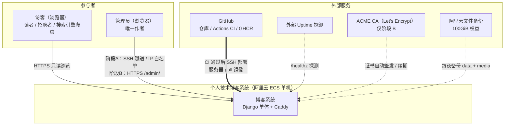
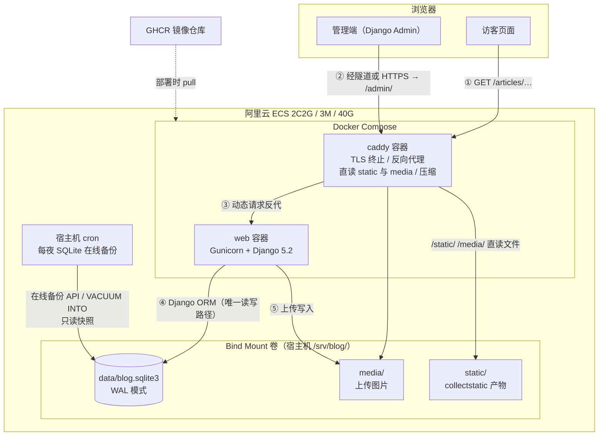
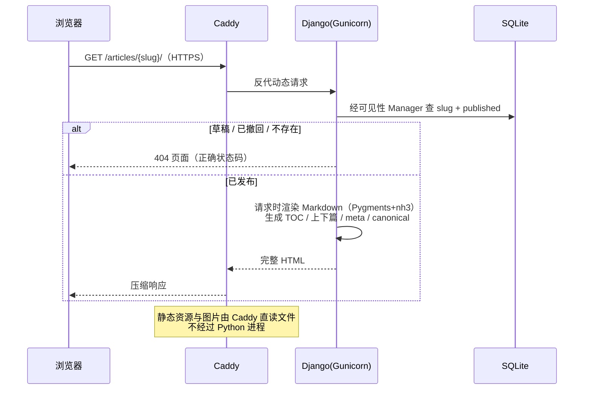
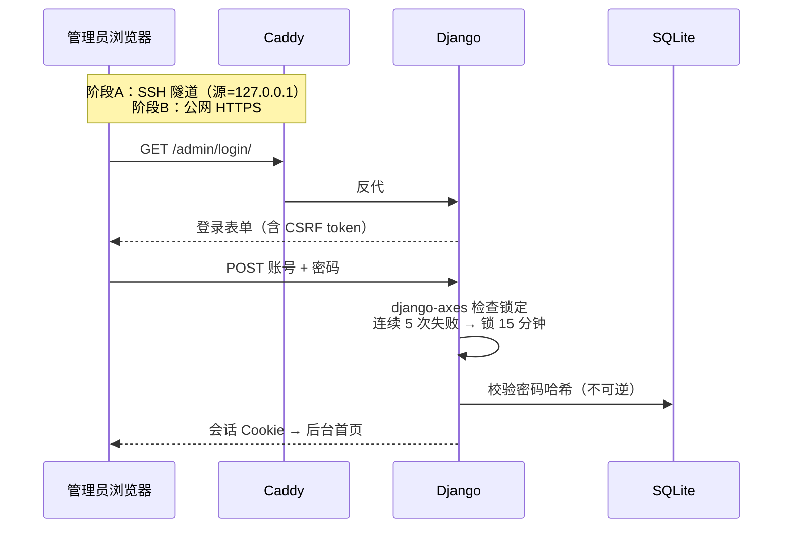
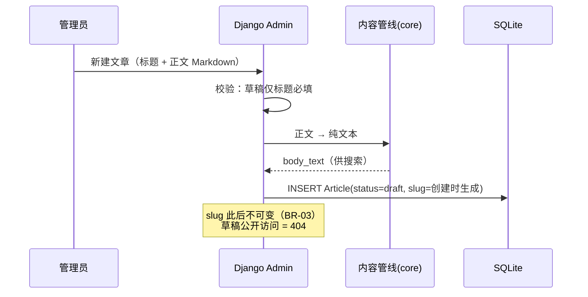
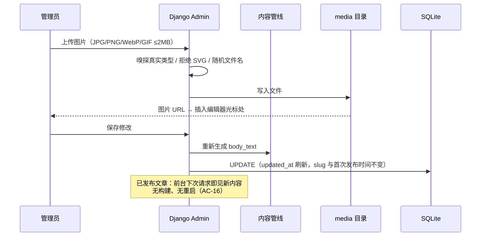
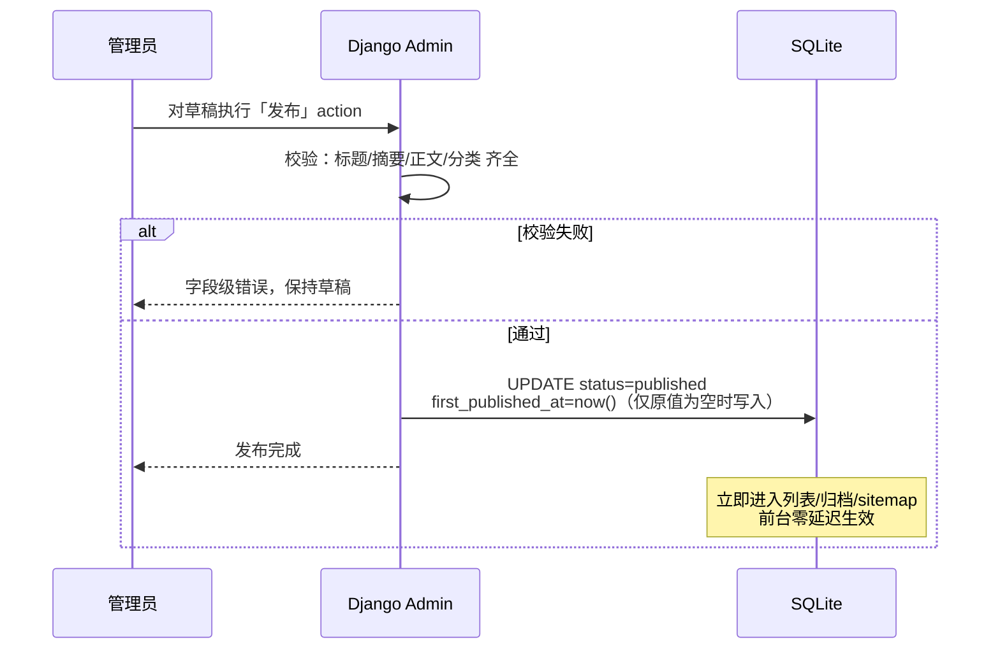
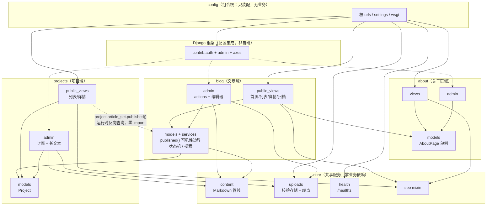

# 架构设计（整体与模块级）

> 文档版本：v1.0
> 文档状态：**已批准**（2026-10-23 用户确认，作为架构基线）
> 编写日期：2026-10-23
> 上游输入：`requirements-analysis.md` v1.1、`technology-selection.md` v1.1、`technology-decisions.md` v1.0（D-01～D-09）
> 配套文档：`database-design.md`、`api-design.md`、`security-design.md`、`deployment-design.md`
> 本文档由原 `architecture-design.md` 第一、二部分迁移而来；一致性审查结论见第 17 节。

## 第一部分：整体系统架构

### 1. 系统边界

系统是部署在单台阿里云 ECS 上的 Django 单体，边界划分如下：

| 边界 | 内容 | 信任级别 |
|---|---|---|
| 访客端 | 浏览器（读者 / 招聘者 / 爬虫），只读公开页面 | 不可信，仅获得已发布内容 |
| 管理端 | 浏览器访问 Django Admin；阶段 A 经 SSH 隧道或安全组白名单，阶段 B 经 HTTPS | 半信任，需认证 |
| 后端服务 | Docker Compose 内两个容器：`web`（Gunicorn + Django）、`caddy` | 内部网络互通 |
| 数据层 | SQLite 文件 + media 目录（bind mount 挂载进容器） | 仅容器网络与宿主机可达 |
| 外部服务 | GitHub（仓库 / Actions / GHCR）、阿里云文件备份、外部 uptime 探测、ACME CA（阶段 B） | 各自独立边界 |

明确的"不在系统内"：无 Redis / 消息队列 / 搜索服务 / CDN；无 Node 构建链；无独立前端工程；无 REST API。

### 2. 系统上下文图



### 3. 容器级架构与部署拓扑

镜像在 GitHub Actions 内构建并推 GHCR（不在 2C2G 服务器上构建）；SQLite 与 media 以 bind mount 持久化。部署序列、环境差异与运维细节见 `deployment-design.md`。



**阶段差异（ADR-06 双阶段上线）**

- **阶段 A**：无域名，Caddy 以 HTTP 服务公开站；`/admin/` 流量仅来自 SSH 隧道（源 = 127.0.0.1）或安全组放行的本人 IP；`SITE_URL=http://<ECS-IP>`。
- **阶段 B**：域名解析 + ICP 备案完成后，Caddy 自动申请证书启用 HTTPS，切换 `SITE_URL`，后台可公网访问（仍有认证 + 登录锁定保护）。

### 4. 模块职责

#### 4.1 容器与基础设施层

| 模块 | 职责 | 输入 | 输出 | 依赖 |
|---|---|---|---|---|
| Caddy | TLS 终止、HTTP→HTTPS 跳转（阶段 B）、反向代理、直读 static/media、gzip/zstd 压缩 | 80/443 流量 | 转发到 web 或直接返回文件 | web 容器、static/media 卷 |
| Gunicorn | WSGI 进程 / worker 管理（2 workers × 2 threads 起步，部署阶段压测微调） | 来自 Caddy 的 HTTP | WSGI 调用 | Django 应用 |
| 宿主 cron 备份 | 每夜生成 SQLite 一致性快照，保留 14 天 | DB 文件 | `/srv/blog/backups/*.sqlite3` | sqlite3 CLI（在线备份 API） |
| GitHub Actions | 六门禁 + 镜像构建 → tag 触发部署 | push、PR、tag | GHCR 镜像 + SSH 到 ECS 执行部署序列 | GHCR、ECS SSH |

#### 4.2 Django 应用内部模块（逻辑视图）

| 模块 | 职责 | 输入 | 输出 | 依赖 |
|---|---|---|---|---|
| 公开视图层 | 首页、文章列表/详情、归档、项目列表/详情、关于、404/500 | HTTP 请求 | 渲染 HTML | 模型层（可见性边界）、内容管线、模板 |
| Django Admin | 文章/项目/关于页 CRUD、发布/撤回 action、图片上传、密码修改、登录锁定 | 管理员表单 | 数据写入、后台页面 | 模型层、django-axes、内容管线 |
| 模型层 + 可见性 Manager | 实体、约束、状态机；"已发布"过滤的唯一收口（BR-05/06） | ORM 调用 | QuerySet | SQLite（经 ORM） |
| 内容管线（core） | Markdown→HTML、nh3 净化、Pygments 高亮、TOC、`body_text` 生成 | Markdown 文本 | 安全 HTML / 纯文本 | Python-Markdown、Pygments、nh3 |
| SEO 层 | sitemap、robots.txt、canonical、meta、404 状态码 | 模型查询 + `SITE_URL` | XML / meta 标签 | 模型层、settings |
| 上传校验（core） | 真实类型嗅探、≤2MB、禁 SVG、随机文件名 | multipart 文件 | media 目录文件 + URL | Pillow、media 卷 |
| /healthz | DB 可读、磁盘余量、备份文件新鲜度 | HTTP GET | 200 / 503 | DB、卷 |

**可见性收口规则**：列表、详情、搜索、归档、上下篇、项目关联文章、sitemap 七处消费点全部调用同一个"已发布"查询边界（模型 Manager `published()`），任何视图不得自行拼 `status='published'` 过滤。

### 5. 核心业务数据流

#### 5.1 访客浏览文章



#### 5.2 管理员登录



#### 5.3 创建草稿



#### 5.4 编辑文章（含图片上传）



#### 5.5 发布文章



### 6. 职责边界与数据库访问规则

**前后端边界**：

- 浏览器端只有 Django 模板输出的 HTML + 少量 HTMX/Alpine 行为；零业务逻辑、零授权判断——所有权限判断在服务端，前端只是展示层。
- HTMX 仅用于后台局部交互（如图片上传回填）；公开站尽量纯 HTML + CSS。

**数据库访问规则（架构红线）**：

| 路径 | 允许 | 说明 |
|---|---|---|
| web 容器内 Django ORM | 允许（唯一读写路径） | 应用代码不得出现裸 SQL、不得绕过 ORM |
| 宿主 cron 备份脚本 | 仅只读 | 经 SQLite 在线备份 API / `VACUUM INTO`，禁止运行时 `cp` |
| Caddy | 禁止 | 只读 static/media 文件，不接触 DB |
| 人工 SSH | 仅运维 | 故障排查只读查询；写操作必须走应用或迁移 |

### 7. 架构风格与 App 划分

**选型：模块化单体（modular monolith）**——进程内按业务域拆 Django app、显式依赖规则；进程外单一部署单元。

| 方案 | 结论 | 原因 |
|---|---|---|
| 单 app 单体 | 否 | 职责混杂、测试定位难、内容增长后腐化快 |
| **模块化单体** | **是** | 边界清晰、可独立测试、Django 原生支持、部署复杂度不增加 |
| 前后端分离（SPA + API） | 否 | SEO/认证/CSRF 全自研，违背已确认的 D-02 |
| 微服务 | 否 | 无多团队并行与独立扩展需求，运维成本爆炸 |

**App 划分（五包）与依赖规则**：

```
config/      settings（dev/test/prod 拆分）、根 urls、wsgi
core/        无业务模型：内容管线、SEO 基类、通用工具
blog/        Article / Category / Tag + 公开视图 + Admin 注册
projects/    Project + 公开视图 + Admin 注册
about/       AboutPage 单例 + 视图 + Admin 注册
```

- `core` 不依赖任何业务 app；三个业务 app 都可依赖 `core`。
- `Article.project` 外键指向 `projects`（blog → projects 单向模型依赖）。
- projects 详情页查关联文章时，经 Django 反向关系调用 blog 暴露的查询接口（`project.article_set.published()`），零代码导入。

### 8. 首版范围与扩展空间

**V1 实现**：公开站全部页面、Admin 全部能力（含密码修改）、内容管线、SEO 层、上传校验、/healthz、CI/CD 全流水线、备份脚本、uptime 接入。

**预留扩展（设计留缝，暂不实现）**：

| 扩展能力 | 留缝方式 | 实现成本预留 |
|---|---|---|
| RSS/Atom | 复用可见性查询边界，加一个 feed 视图 | 低 |
| FTS5 全文搜索 | 搜索已封装为 service 函数，`body_text` 已落库 | 中 |
| PostgreSQL 迁移 | 全 ORM 无裸 SQL；DB 配置单点 | 中 |
| 渲染缓存 | 渲染函数签名稳定，可直接加缓存装饰器 | 低 |
| 媒体库 / OSS | 上传模块独立；`MEDIA_URL` 可配置 | 中 |
| 评论 | 文章详情模板预留区块位；不建表不加字段 | 高 |
| 多作者 | Django auth 原生可扩展；不预建字段 | 中 |
| CDN | `STATIC_URL` / `MEDIA_URL` 可配置即可切 | 低 |

### 9. 风险分析

| 风险 | 类型 | 影响 | 概率 | 缓解措施 |
|---|---|---|---|---|
| ECS 整机故障 | 单点 | 全站不可用 | 低 | 备份 + 每月恢复演练；compose/脚本全部入库，可在新机重建；接受单点（预算内理性选择） |
| SQLite 损坏 | 数据 | 数据丢失 | 很低 | 本地盘 + WAL + `synchronous` 明确配置；禁止 NFS；每夜快照 |
| 磁盘写满 | 资源 | 写入/上传失败 | 中 | /healthz 磁盘阈值告警；图片 ≤2MB；备份保留期限额 |
| 3M 带宽饱和 | 性能 | 页面变慢 | 中 | 首屏预算 ≤500KB、懒加载、Caddy 压缩；后续 CDN |
| 请求时渲染 CPU | 性能 | TTFB 上升 | 低 | 已留缓存升级缝 |
| `icontains` 全表扫描 | 性能 | 搜索变慢 | 低（<1000 篇） | FTS5 升级路径已定（ADR-09） |
| 证书续期失败（阶段 B） | 安全 | 浏览器告警 | 低 | Caddy 自动化 + uptime 监控 |
| GitHub 访问抖动 | 部署 | CI/CD 延迟 | 中 | pip/Docker 镜像加速；手动部署脚本兜底 |
| 后台暴力破解 | 安全 | 账户风险 | 中 | axes 锁定 + 隧道/白名单 + 强密码 |
| 备份静默失败 | 数据 | "假备份" | 中 | /healthz 校验备份文件新鲜度；每月演练验证可恢复 |

**性能判断**：读路径无缓存瓶颈（量级不支撑）；SQLite WAL 下读并发不限、写串行且只有单管理员写——性能天花板远高于预期流量，无需预优化。

**维护成本**：日常零干预；每月例行约 2 小时（依赖升级 PR 审查 1h + 备份演练 0.5h + 日志/磁盘巡检 0.25h）。

### 10. 架构决策记录 AD-1～AD-10

| # | 决策 | 依据 | 替代方案（不选原因） | 成本/风险 |
|---|---|---|---|---|
| AD-1 | 两容器：web + caddy，单一部署单元 | 最小活动部件；镜像 Actions 内构建 | systemd 裸部署（不可重复）；加 Nginx（与 Caddy 职能重复） | 极低 |
| AD-2 | 模块化单体（Django apps） | 边界 + 可测试性，部署复杂度不增 | 微服务（无对应需求）；单 app（腐化） | 需维护依赖纪律 |
| AD-3 | 请求时渲染 Markdown，V1 无缓存 | 当前流量不构成瓶颈；避免缓存失效逻辑 | 预渲染落库（管线升级需刷全量数据）；请求时+缓存（V1 复杂度不值） | 流量增长后加缓存（已留缝） |
| AD-4 | DB 访问仅两条路径：ORM（唯一读写）+ 备份脚本（只读快照） | 安全边界清晰可审计 | 任意绕过（禁止） | 低 |
| AD-5 | static/media 由 Caddy 直读 | 不消耗 Python worker | Django serve（仅限 DEBUG） | 低 |
| AD-6 | 可见性过滤收口于模型 Manager | BR-05/06 七处消费点一处实现 | 各视图自拼过滤（草稿泄漏风险） | 低 |
| AD-7 | 内容管线放 core，文章与项目共用 | 两域都有 Markdown 字段 | 复制两份实现（逻辑漂移） | 低 |
| AD-8 | 阶段 A 后台防护在基础设施层（隧道/安全组） | 不给应用塞临时逻辑 | Django IP 白名单中间件（阶段 B 成残留死代码） | 依赖运维纪律 |
| AD-9 | App 五包划分 config/core/blog/projects/about | 域边界清晰；FK 单向 + 反向关系查询是 Django 常规做法 | 合并 blog+projects 为 content（边界变粗） | 低 |
| AD-10 | /healthz = DB 可读 + 磁盘余量 + 备份新鲜度 | 覆盖三大静默故障（应用死、盘满、假备份） | 仅进程存活检查（覆盖不足） | 低 |

### 11. 需求追溯（整体架构部分）

| 需求/决策 | 架构落点 |
|---|---|
| AC-16/AC-19 立即生效 | AD-1/AD-3：服务端请求时渲染，发布路径无构建 |
| BR-05/BR-06 可见性 | AD-6：Manager 收口，七处消费点 |
| BR-03 URL 稳定 | slug 字段创建时生成后不可变（见 database-design.md） |
| BR-04 首次发布时间 | 状态机：仅原值为空时写入（见 database-design.md） |
| BR-09 删除语义 | on_delete 策略（见 database-design.md） |
| D-09 搜索 | `body_text` 字段 + 搜索 service 函数 |
| NFR-SEC-04/05 净化与上传安全 | 内容管线（nh3）+ 上传校验（Pillow 嗅探），见 security-design.md |
| ADR-06 双阶段 | `SITE_URL` 单点配置 + AD-8 基础设施层防护 |
| AC-11 登录锁定 | django-axes |
| BR-12 归档时区 | `USE_TZ=True` + `TIME_ZONE=Asia/Shanghai`，归档 Python 侧按本地时间分组 |
| AC-27～AC-30 SEO | SEO 层（sitemap/robots/canonical/404）+ Caddy，见 api-design.md |
| AC-38 工程质量 | CI 六门禁（见 deployment-design.md） |
| 3M 带宽 | 首屏 ≤500KB 预算 + Caddy 直读与压缩 |

## 第二部分：模块级架构

### 12. 模块独立性判定

| 候选模块 | 判定 | 落点 | 理由 |
|---|---|---|---|
| 文章管理 | 独立（域核心） | blog app | 独立数据所有权、状态机、完整生命周期 |
| 分类与标签 | 不独立 | blog.models | Category 固定 3 行查找表、Tag 为 M2M 附属，脱离文章无独立生命周期 |
| 公开内容查询 | 不独立为模块 | blog 的 `published()` Manager + 各域 public_views | 是模式不是模块：过滤逻辑收口在一处，查询散在各域视图 |
| 管理员认证与权限 | 不自研 | Django 框架配置集成 | 认证/会话/CSRF/锁定全是框架能力，自研即重复造轮子 |
| 搜索与分页 | 不独立 | `search_articles()` 函数 + Django Paginator | 搜索是函数（D-09），分页是框架特性 |
| Markdown 内容处理 | 独立 | core.content | 跨域复用（AD-7），有独立安全边界与演化节奏 |
| 图片及静态资源 | 部分独立 | core.uploads；静态/媒体服务归 Caddy；媒体库非 V1 | 上传校验被两个 Admin 消费；"资源服务"是部署层的事 |
| 系统配置与健康检查 | 拆开处理 | config = 组合根；core.health = 小模块 | settings 是框架配置；/healthz 有独立消费方与故障语义 |

结论：8 项中 3.5 项需要真实模块化（blog 域、Markdown 管线、上传服务、健康检查），其余是函数、模式或框架配置。

### 13. 模块结构

```
config/                  组合根：settings 拆分、根 urls（纯 include）、wsgi、框架集成配置
core/
  content.py             Markdown 管线（render / to_text）
  uploads.py             图片校验、随机命名、存储 + staff-only 上传端点
  health.py              /healthz 三项检查
  seo.py                 meta/canonical 模板上下文 mixin
blog/
  models.py              Article/Category/Tag + published() Manager + 状态机
  services.py            search_articles 等
  public_views.py        首页 / 列表 / 详情 / 归档
  admin.py               ModelAdmin、发布/撤回 action、Markdown 编辑器
  sitemaps.py            文章 sitemap
projects/                models / public_views / admin / sitemaps
about/                   models（单例）/ views / admin / sitemaps
```

### 14. 模块卡片

#### M1 blog —— 文章域

| 属性 | 内容 |
|---|---|
| 职责 | Article/Category/Tag 模型与约束；文章状态机；可见性查询边界 `published()`（七处消费点唯一入口）；搜索服务；公开视图（首页/列表/详情/归档）；Admin 注册与发布/撤回 action；文章 sitemap |
| 不负责 | Markdown→HTML 实现（core.content）；图片校验存储（core.uploads）；项目详情页渲染；认证权限；首页的关于摘要数据 |
| 对外接口 | HTTP：首页/列表/详情/归档（见 api-design.md）；Python：`Article.objects.published()`、`search_articles(q, category, tag)`、`Article.publish()` / `Article.withdraw()` |
| 依赖 | core.content、core.uploads、projects.models（FK）、about.get_solo()（首页摘要） |
| 数据模型 | Article、Category、Tag（见 database-design.md） |
| 异常 | 发布校验失败；草稿/不存在→404；页码越界→404；搜索无结果→空状态；slug 冲突重试；标签重复→归一化复用 |
| 测试 | 状态机全路径；可见性七处一致性；slug 唯一与不可变；标签归一化；搜索组合交集；删除语义；归档时区分组 |
| 未来变化影响 | FTS5→只改 search_articles；RSS→新增视图；评论→详情视图与模板扩展；Q-04 复审→模型加字段。均不影响 projects/about/core |

#### M2 projects —— 项目域

| 属性 | 内容 |
|---|---|
| 职责 | Project 模型；公开列表/详情视图（空字段区块隐藏）；Admin；项目 sitemap |
| 不负责 | 关联文章的可见性与排序（经 blog 的 `published()` 消费）；Markdown 渲染实现 |
| 对外接口 | HTTP：项目列表/详情；Python：`Project` 模型；关联文章经 `project.article_set.published()` 获取（零 import） |
| 依赖 | core.content、core.uploads；对 blog 零代码导入 |
| 数据模型 | Project |
| 异常 | 项目不存在→404；URL 非法→字段级；删除二次确认+关联提示 |
| 测试 | 空字段隐藏；删除后文章 project 置空；-updated_at 排序；封面缺失占位 |
| 未来变化影响 | Q-02 复审→模型加字段+可见性逻辑（影响 blog 关联查询与 sitemap） |

#### M3 about —— 关于页域

| 属性 | 内容 |
|---|---|
| 职责 | AboutPage 单例模型（`get_solo()`）；公开视图；跨字段校验；单例 Admin；about sitemap |
| 不负责 | 首页聚合（blog 负责，本模块仅提供 home_summary）；富文本/档案系统 |
| 对外接口 | HTTP：关于页；Python：`AboutPage.get_solo()` |
| 依赖 | core.seo mixin；无业务依赖 |
| 数据模型 | AboutPage |
| 异常 | clean 校验失败；URL 非法 |
| 测试 | 单例 get_or_create；至少一项联系方式；保存后前台即时可见 |
| 未来变化影响 | 字段结构演化仅影响本模块与模板 |

#### M4 core.content —— Markdown 管线

| 属性 | 内容 |
|---|---|
| 职责 | Markdown→安全 HTML（Pygments 高亮、TOC、nh3 白名单净化）；Markdown→纯文本（body_text） |
| 不负责 | 存储与字段定义；编辑器 UI；缓存（V1 无）；渲染时机 |
| 对外接口 | `render_markdown(md) -> (html, toc)`；`markdown_to_text(md) -> str` |
| 依赖 | 仅三方库；零项目内依赖 |
| 数据模型 | 无 |
| 异常 | 危险 HTML→净化剥离不抛错；畸形 Markdown→容错渲染；超长文档→接受耗时 |
| 测试 | XSS 净化用例集；代码高亮；TOC 层级；去标记纯文本；两域渲染一致 |
| 未来变化影响 | 换渲染器/加缓存→签名不变；影响方仅 blog、projects 且无感 |

#### M5 core.uploads —— 图片校验与存储

| 属性 | 内容 |
|---|---|
| 职责 | 魔数嗅探、≤2MB、禁 SVG、随机文件名、写入 media、返回 URL；staff-only 上传端点 |
| 不负责 | 媒体库/删除/孤儿清理（非 V1）；静态与媒体服务（Caddy）；OSS |
| 对外接口 | `store_image(file) -> (url, path)`；HTTP 上传端点（staff + CSRF，见 api-design.md U1） |
| 依赖 | Pillow、settings；零项目内依赖 |
| 数据模型 | 无表（DM-5） |
| 异常 | 类型/大小/损坏→拒绝并保留编辑器内容 |
| 测试 | 四格式通过；SVG 拒绝；伪装扩展名拒绝；2MB 边界；文件名随机性 |
| 未来变化影响 | OSS→换存储实现；媒体库→加表；调用方接口不变 |

#### M6 core.health —— 健康检查

| 属性 | 内容 |
|---|---|
| 职责 | `/healthz`：DB 可读 + 磁盘余量 + 备份新鲜度；200/503 + JSON 摘要 |
| 不负责 | 告警发送（外部 uptime）；业务监控；日志分析 |
| 对外接口 | HTTP GET /healthz |
| 依赖 | DB 连接、卷路径配置 |
| 数据模型 | 无 |
| 异常 | 三项任一失败→503 |
| 测试 | 三项分别注入失败断言 503；正常 200 |
| 未来变化影响 | 加检查项→扩展列表；消费方无感 |

#### M7 config —— 组合根 + 框架集成

| 属性 | 内容 |
|---|---|
| 职责 | settings 拆分（base/dev/test/prod、`SITE_URL` 单点、环境变量 fail-fast）；根 urls 纯 include；wsgi；框架集成：auth/admin、axes、CSRF、sitemap wiring、404/500 模板 |
| 不负责 | 任何业务逻辑、数据模型、跨域查询 |
| 对外接口 | 配置与路由树本身 |
| 依赖 | 五个 app 的 urls/sitemaps（组合根方向） |
| 数据模型 | 无自定义（框架迁移创建） |
| 异常 | 环境变量缺失→启动失败；EX-01～04 认证异常；404/500 统一模板 |
| 测试 | check --deploy；settings 完整性；E2E：登录/锁定/越权/会话失效 |
| 未来变化影响 | 阶段 B SITE_URL 切换→仅改环境变量；新增 app→加一行 include |

### 15. 模块依赖图与依赖规则



图例：实线 = 代码依赖（import）；虚线 = 运行时关系（无代码导入）。

| 规则 | 对应约束 |
|---|---|
| R1 代码依赖图为 DAG 无环；blog↔projects 双向业务关系拆解为"模型层单向 FK（blog→projects）+ 运行时反向查询（零导入）" | 避免循环依赖 |
| R2 urls.py 只 include；视图只做"取参→调 Manager/服务→渲染"，业务规则全在模型与服务层 | 路由层不承担业务 |
| R3 数据库访问一律 Django ORM + Manager；跨域查询只经被访域暴露的查询接口 | 访问方式一致 |
| R4 认证/CSRF/会话/锁定/404/500 全用框架，不自研不重复 | 不重复实现 |
| R5 搜索=函数、分页=框架特性、标签唯一性=模型 clean、认证=框架，均不设独立模块 | 不为简单函数建模块 |
| R6 媒体库/FTS5/RSS/评论/渲染缓存只出现在"未来变化"列，不进 V1 职责列 | 未决功能不进 V1 |

### 16. 方案比较

| 方案 | 为什么不选 |
|---|---|
| 更简单：单 app | 三域生命周期不同；单文件膨胀；测试定位差 |
| 更简单：八项全建模块 | 搜索是函数、分页是框架特性、认证是框架——碎模块比没有模块更难维护 |
| 更复杂：合并 blog+projects 为 content | 域边界变粗；Q-01/Q-02 复审会互相牵连 |
| 更复杂：独立"公开站" app | 视图与模型分家的上帝 app，依赖全域 |
| **推荐：5 app + core 共享服务** | 边界与数据所有权对齐；横向能力集中；代码依赖 DAG；加法演化；粒度克制 |

### 17. 一致性审查结论（2026-10-23）

九项检查点结论、已修正问题与遗留事项已并入各配套文档（修正处均有标注，如 `api-design.md` 的 EX-16 降级约定、`deployment-design.md` 的 OPS-7 部署序列补齐）。要点：

1. FR-01～23、EX-01～20 逐项核对，全部有模块与接口落点（明细见 api-design.md 追溯列）。
2. 未发现无需求依据的模块、表或服务；明确排除项维持排除。
3. BR-01～20 全部有数据模型支撑（见 `database-design.md` §3 数据字典与 §10 设计决策汇总）。
4. 接口契约与字段、权限、状态机三向一致（见 api-design.md）。
5. 代码依赖 DAG 无环；管线/上传/可见性各自单一归属，无职责重叠。
6. 安全要求全部有设计与验收落点（见 security-design.md）。
7. 测试方案覆盖关键业务与风险（见 deployment-design.md 测试设计部分）。
8. 部署架构与选型、预算、单人维护能力一致（见 deployment-design.md）。
9. 无过度设计；两项扩展成本风险如实标注（Admin 编辑器 JS 工作量、阶段 B 切换人工核验）。
