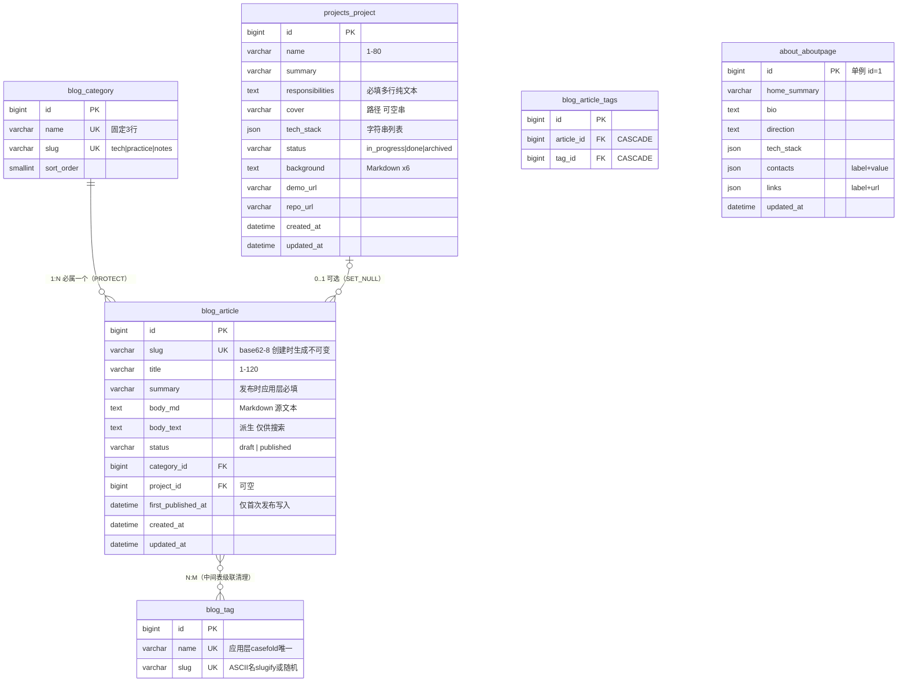

# 数据库设计

> 文档版本：v1.0
> 文档状态：**已批准**（2026-10-23 用户确认，作为架构基线）
> 编写日期：2026-10-23
> 上游输入：`requirements-analysis.md` v1.1、`technology-decisions.md` v1.0、`architecture.md`
> 本文档由原 `architecture-design.md` 第三部分迁移而来。
> 迁移工具一致性说明：已确认技术栈为 Django ORM + Django 内置迁移（ADR-01）；Alembic 属未选择的 SQLAlchemy 路线，不采用。

## 1. 持久化实体与存在理由

| 实体 | 存在理由 | 来源需求 |
|---|---|---|
| Article | 内容核心：状态机、可见性、搜索、SEO 围绕它 | FR-01～07、BR-03～06 |
| Category | 固定三类导航与筛选锚点 | BR-01 |
| Tag | 技术主题横向串联（自由 folksonomy） | BR-02 |
| Project | 作品集展示与文章关联 | FR-08～10、BR-08/09 |
| AboutPage | 后台可编辑单例页面 | BR-15 |
| 框架表 | 认证、会话、后台审计（django_admin_log 免费）、迁移记录 | ADR-01/04 |

明确排除：UploadedImage（DM-5）、ArticleVersion（DM-10）、Comment（范围外）。

## 2. 实体关系图

SQLite 存储注记：DATETIME 以 ISO 8601 文本存储（USE_TZ=True 存 UTC）；JSONField 以 TEXT 存储；字符串类字段空值存 '' 不存 NULL（Django 惯例）。

## 3. 数据字典

### 3.1 blog_article

| 字段 | 类型 | NULL | 默认 | 约束 / 索引 / 说明 |
|---|---|---|---|---|
| id | BigAutoField | 否 | 自增 | PK |
| slug | CharField(16) | 否 | 生成 | UNIQUE；创建时随机 base62-8、冲突重试；此后不可变（Admin 只读 + 测试守护） |
| title | CharField(120) | 否 | — | 必填 |
| summary | CharField(200) | 否 | '' | 发布时应用层必填 |
| body_md | TextField | 否 | '' | Markdown 源；草稿可空 |
| body_text | TextField | 否 | '' | editable=False；保存时由 core.content 生成 |
| status | CharField(10) | 否 | 'draft' | choices: draft / published |
| category_id | FK → blog_category | 否 | — | PROTECT；索引自动 |
| project_id | FK → projects_project | 是 | NULL | SET_NULL（BR-09）；索引 |
| first_published_at | DateTimeField | 是 | NULL | 仅首次发布写入 |
| created_at / updated_at | DateTimeField | 否 | — | auto_now_add / auto_now |

显式索引：UNIQUE(slug)；Index(status, first_published_at DESC)。

### 3.2 blog_category（固定 3 行，数据迁移种子）

name CharField(20) UNIQUE；slug CharField(20) UNIQUE（tech/practice/notes）；sort_order SmallIntegerField（1/2/3）。种子：技术文章/tech/1、项目实践/practice/2、学习复盘/notes/3。Admin 禁增删。

### 3.3 blog_tag

name CharField(20) UNIQUE（保存前 strip；latin 大小写不敏感唯一由应用层 clean 保证）；slug CharField(16) UNIQUE（ASCII 名 slugify，中文名 6 位随机短串）。

### 3.4 blog_article_tags（M2M 中间表，自动生成）

article_id FK CASCADE；tag_id FK CASCADE；UNIQUE(article_id, tag_id)。

### 3.5 projects_project

name CharField(80) 必填；summary CharField(200) 必填；responsibilities TextField 必填（多行纯文本）；cover ImageField 默认 ''（upload_to 随机命名 covers/%Y/%m/）；tech_stack JSONField 默认 []（list[str]，每项 ≤30 字去重）；status CharField(20) 默认 in_progress（in_progress/done/archived）；background/goals/features/architecture/challenges/solutions TextField ×6 默认 ''（Markdown）；demo_url/repo_url URLField ×2 默认 ''；created_at/updated_at。列表按 -updated_at 排序。

### 3.6 about_aboutpage（单例 id=1，get_or_create 保证）

home_summary CharField(200) 必填；bio TextField 必填；direction TextField 默认 ''；tech_stack/contacts/links JSONField 默认 []（contacts=[{label,value}]，links=[{label,url}]）；updated_at auto_now。模型 clean：contacts 与 links 至少一项。

### 3.7 框架表（框架迁移创建，不参与业务设计）

auth_user 及权限表组（1 行超级管理员）；django_session；django_admin_log（后台操作审计）；django_content_type / django_migrations；axes_*（登录尝试与锁定）。

## 4. 文章状态与转换规则

| 当前状态 | 事件 | 守卫条件 | 动作 | 结果状态 |
|---|---|---|---|---|
| （新建） | 创建 | 标题非空 | 生成 slug；生成 body_text | draft |
| draft | 发布 | 标题/摘要/正文/分类齐全 | status=published；first_published_at 原值为空才写 now | published |
| draft | 发布 | 校验失败 | 不落库，字段级报错 | draft |
| draft | 保存 | — | 重生成 body_text | draft |
| published | 保存 | — | 同上；slug 与 first_published_at 不变 | published |
| published | 撤回 | — | status=draft，保留 first_published_at | draft |
| draft / published | 删除 | Admin 二次确认 | 硬删除行 + M2M 级联清理 | ∅ |

不变量（测试强制）：status='published' ⇒ first_published_at IS NOT NULL。转换集中在模型服务方法（事务内），视图与 Admin 只调用。

## 5. 分类与标签设计

| 设计点 | 结论 |
|---|---|
| 分类与标签分开建模 | 分类 = 固定 taxonomy（BR-01 锁定，导航/URL 锚点）；标签 = 自由 folksonomy（BR-02 编辑中创建） |
| Category ↔ Article | 1:N，FK 在 Article，PROTECT |
| Article ↔ Tag | N:M，中间表 UNIQUE 防重，双向 CASCADE |
| 标签创建 | 仅文章编辑内（Admin M2M 弹窗），无独立管理页（Q-03） |
| 孤儿标签 | 允许存在，公开页面不展示（BR-02；视图只从已发布文章带出标签） |

## 6. slug、时间戳与删除策略

**时间戳分工**：created_at（INSERT 一次，审计）；updated_at（每次 UPDATE，Admin/项目列表排序 BR-11）；first_published_at（首次发布一次，全部公开排序：列表/归档/上下篇/sitemap；撤回再发布不变 BR-04）。三者语义互不重叠，非冗余。

**slug**：随机 base62-8、DB 唯一、冲突重试、创建后不可变——URL/外部链接/canonical/sitemap 与内容编辑完全解耦。

**删除矩阵**：删 Article → 行 + M2M 级联；删 Project → 文章 SET_NULL；删 Category → PROTECT 拒绝；删文章不删媒体文件（BR-17，孤儿由磁盘监控兜底）。

**软删除否决（DM-9）**：需求 10.2 无回收站；软删除使七处消费点查询复杂度翻倍；单人 + 二次确认 + 每夜备份已提供恢复路径。

**版本历史否决（DM-10）**：需求 10.2 明确排除；夜间备份提供粗粒度恢复；未来需要时加版本表 + 保存钩子，属加法演进，不预留字段。

## 7. 事务、并发与一致性

SQLite 连接配置：WAL；busy_timeout≈5000ms；PRAGMA foreign_keys=ON（Django 对 SQLite 默认启用，测试断言）；synchronous=NORMAL（DM-15）。

| 操作 | 事务边界 |
|---|---|
| Article.publish() / withdraw() | transaction.atomic（服务方法内） |
| Admin 表单保存 | Admin 默认将模型 + M2M 包在同一事务 |
| Project 删除 | transaction.atomic（DELETE + SET_NULL） |
| AboutPage.get_solo() | get_or_create 原子语义 |
| 每夜备份 | SQLite 在线备份 API（WAL 下无锁快照） |

不开启全局 ATOMIC_REQUESTS（DM-11）。

一致性不变量（均有测试断言）：published ⇒ first_published_at 非空；body_md 保存后 body_text 同步；FK 完整性按删除矩阵；M2M 无重复；标签归一化唯一；slug 唯一且不变。

并发：单写者（唯一管理员）+ WAL；EX-19 后保存覆盖为确认行为；乐观锁否决（DM-14）。

## 8. 迁移策略与备份恢复

**Django migrations 规则**：schema 变更只经 makemigrations；迁移文件入 git 评审；禁止手改生产库与已应用迁移；部署顺序 pull → migrate → collectstatic → up -d（见 deployment-design.md）；Category 种子走幂等数据迁移；SQLite 事务性 DDL——迁移失败整体回滚。

**变更模式**：加列（带默认）安全；删列先下线引用再删；改名/改型走三步法（新列 + 数据迁移回填 + 删旧列，跨两个发布，DM-12）；管线升级提供 body_text 全量重算管理命令。

**备份（双层）**：本地层——每日 02:00 宿主 cron 执行 sqlite3 .backup + media tar，保留 14 天（ADR-08 窗口内取中）；灾难层——阿里云文件备份覆盖 /srv/blog。**恢复流程（月度演练）**：停写入 → 快照替换 → 启动 → 验证文章/图片/关于页 → 记录。RPO = 24h（无 PITR，DM-13）。

## 9. 字段变更兼容性（兼容面 = URL + 模板 + 模块接口，无 REST API）

| 变更 | 数据影响 | 兼容性影响 |
|---|---|---|
| slug（内容编辑永不触发） | 无 | 外部链接/canonical/sitemap 零影响 |
| 加列 | 无 | 模板未引用前无感 |
| 删列 | 数据丢失 | 先改模板与模块引用，跨版本 |
| JSON 加键 | 无 | 模板容错缺失键 |
| 管线升级 | body_text/HTML 重算 | 渲染外观变化，预期内 |
| 换 PostgreSQL | 导出导入 | 模型层零改动（无裸 SQL） |

## 10. 设计决策汇总（DM-1～DM-15）

| # | 决策 | 依据 | 替代方案（不选原因） |
|---|---|---|---|
| DM-1 | slug = base62-8 随机不可变 | 中文标题无法派生；URL 稳定 | 自定义 slug（增加心智负担） |
| DM-2 | 标签唯一性应用层归一化 + DB 精确唯一 | 单管理员可靠 | DB lower() 函数索引（复杂度不值） |
| DM-3 | tech_stack/contacts/links 用 JSONField | 无按内容过滤需求 | M2M/子表（多表无收益） |
| DM-4 | 关于页单例 = 单行表 + get_or_create | 经典模式 | settings 存文本（不可后台编辑） |
| DM-5 | 不建 UploadedImage 表 | BR-17 无媒体库 | 审计表（未来媒体库再加） |
| DM-6 | body_text 保存时生成 | D-09 预生成 | 查询时解析（浪费） |
| DM-7 | 分类种子数据迁移 + PROTECT + Admin 禁删 | 可重放 | fixtures（易漂移） |
| DM-8 | USE_TZ=True + Asia/Shanghai，归档 Python 分组 | BR-12 | SQL 时区转换（SQLite 繁琐） |
| DM-9 | 无软删除 | 需求 10.2；查询复杂度 | deleted_at（回收站需求不存在） |
| DM-10 | 无版本历史 | 需求 10.2 排除 | 版本表（成本高收益低） |
| DM-11 | 事务显式包裹，不开全局 ATOMIC_REQUESTS | 读多写少 | 全局事务（无谓开销） |
| DM-12 | SQLite 变更三步法 | 无 ALTER COLUMN | 就地改型（做不到） |
| DM-13 | 备份双层、14 天、RPO 24h | ADR-08 | PITR（过度设计） |
| DM-14 | 无乐观锁 | EX-19 已确认接受 | version 字段+冲突 UI |
| DM-15 | synchronous=NORMAL | WAL 下折中 | FULL（延迟增大收益边际） |
