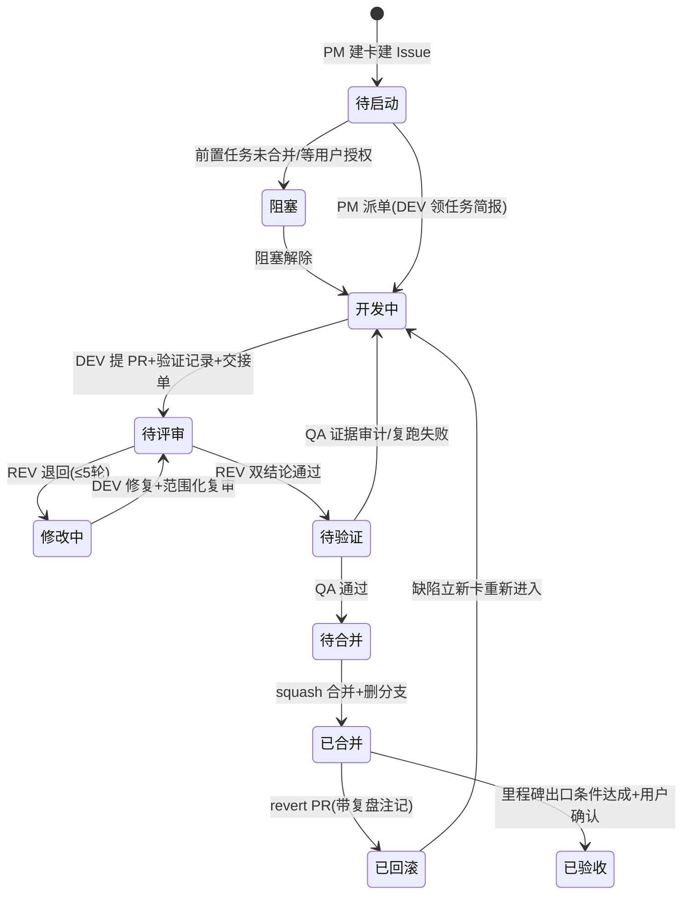

# Git 与多 Agent 协作规范（开发工作流）

> 文档版本：v2.0
> 文档状态：**已批准**（2026-10-24 随开发计划生效；变更需评审升版）
> 编写日期：2026-10-23（v2.0 整合：2026-10-24）
> v2.0 修订：由 `collaboration-rules.md` v1.0 整体并入并更名；指向 task-breakdown §2 的引用改为 `definition-of-done.md` 对应章节；上游同步 task-breakdown v4.0
> 上游输入：`task-breakdown.md` v4.0（依赖与并行 §3.3、Git 约定 §1.4）、`definition-of-done.md` v1.0、`technology-decisions.md` ADR-07、`deployment-design.md` §5/§12
> 文档边界：只定义协作过程规则；任务"完成"的判定标准见 `definition-of-done.md`
> 执行载体说明：DEV/REV/QA 由子代理（fresh subagent）承担，PM 由主会话承担；子代理不继承会话历史，靠任务简报与文件交接

## 1. 角色定义与独立性规则

| 角色 | 承担者 | 职责 | 禁止事项 |
|---|---|---|---|
| **用户** | 你 | 红线操作授权、里程碑验收、需求变更决策 | — |
| **PM（协调）** | 主会话 | 派单与任务简报、维护台账、调度 REV/QA、升级决策、向用户汇报 | **不得亲自写实现代码**（控制器修复会绕过评审） |
| **DEV（开发）** | 全新子代理/任务 | 按任务卡 TDD 实现、自查、填 PR 验证记录、产出交接单 | **不得自批合并**；不得动白名单外文件；不得删/弱断言凑绿（DoD 9） |
| **REV（独立评审）** | 与 DEV 不同实例的子代理 | 对照任务卡+设计文档评审 diff 包，出"规格符合 + 质量"双结论；⚠卡执行 definition-of-done.md §5 加严项 | **不得修改代码**（只评审）；不得被 PM 预设结论（禁止"别报这个问题"式指令） |
| **QA（测试）** | 独立子代理 | 证据审计（PR 验证记录 vs CI 实际输出逐项对照）、抽查复跑（⚠卡全量复跑）、L3/E2E 稳定性 | 不采信粘贴输出，只采信自己复跑与 CI run 链接 |
| **CI（机器）** | GitHub Actions | 六道门禁渐进启用；机器复验 | — |

**独立性铁律**：审查结论永远不得只来自开发者自己。完成判定 = DEV 自查 + REV 独立评审 + CI 机器复验 + QA 证据审计，四者缺一不可；DEV 的自查是必要条件而非充分条件。

**修复循环**：REV 退回后进入"修复→范围化复审"循环，最多 5 轮——第 1～3 轮由原 DEV（上下文还在）修复；第 4～5 轮换全新 DEV 并提升模型档位；第 5 轮仍有未决发现时 PM 强制裁决每条发现（记录裁决理由入台账），属"承重问题"（下游任务依赖它）则 **BLOCKED 停止并上报用户**。

## 2. 分支模型与命名规则

### 2.1 main 保护

- main 是唯一长期分支，恒绿恒可部署；**禁止直接在 main 开发或直推功能提交**（初始化期 T-001 本地初始化提交除外，其 GitHub 远端与分支保护在后续批次收口）。
- 分支保护：PR 必过 CI + 必须至少一个 REV 通过结论；禁 force-push（§9 红线）。
- 合并方式：**squash 合并**（一个任务在 main 上恰一个提交，线性历史，回滚单元=任务）。
- 功能分支生命周期：从最新 main 拉出 → 合并后**立即删除**；分支存活超过 3 个任务周期未合并的，PM 检查是否该废弃或 rebase。

### 2.2 命名规则

```
<类型>/<任务号>-<短名>          短名：小写英文+中划线，≤5 个词
feat/T-018-blog-public-views    功能实现（默认类型）
fix/T-023-admin-form-validation 缺陷修复（缺陷由 PM 立新任务卡后建分支）
docs/T-036-server-runbook       纯文档任务
chore/T-032-ci-report           构建/工具链调整
spike/T-016-editor-proof        一次性技术验证
hotfix/T-0xx-<短名>             紧急生产缺陷（从 main 直接拉，评审不省略）
```

- **无任务号不得建分支**：任何变更先有任务卡（含缺陷），保证"分支 ↔ 任务卡 ↔ Issue 台账"三者一一对应。
- 一个任务一个分支，禁止一个分支塞多任务。

### 2.3 并行隔离（worktree）

并行组（task-breakdown §3.3 的 P1～P6）执行时，每个 DEV 使用独立 **git worktree** 目录（`../wt-T-0xx/`），互不共享工作区；不能提供 worktree 隔离时退化为串行。同一工作区**绝不**同时跑两个 DEV。

## 3. 提交信息规范

### 3.1 PR 内提交（评审粒度，保留在 PR 里）

```
<type>(<scope>): <中文摘要≤50字>
type  ∈ test | feat | fix | docs | chore | refactor
scope ∈ blog | projects | about | core | config | ci | deploy | e2e | docs
示例：
test(blog): 草稿 404 与分页边界用例
feat(blog): 文章列表视图与筛选
docs(runbook): 备份恢复演练章节
```

- 提交序列遵循任务卡"Git"字段（通常 test→实现→收尾）；**一个提交只做一件事**。
- 禁止：`update`、`fix`、`改动` 这类无信息标题；禁止混合多语义改动。

### 3.2 squash 合并标题（main 上的最终形态）

```
T-0xx(<scope>): <任务卡短名>
示例：T-018(blog): 公开视图与模板
```

与任务卡 Git 字段逐字一致——台账与 git log 可互相检索。

## 4. 任务台账与状态流转

### 4.1 台账：GitHub Issue（每任务一个，PM 在派单时创建；远端就绪前以 docs/execution-log.md 代行）

```markdown
标题：[T-0xx] 任务名（Mx · ⚠类别）
里程碑：M2　风险标签：⚠I
验收三场景：正常 … / 边界 … / 失败 …（从任务卡复制）
状态：待启动 ←（编辑本行更新，见 4.2）
证据区：PR #__ ｜ CI run __ ｜ REV 结论 __ ｜ QA 结论 __
变更记录：（需求变更/退回次数/裁决，按时间追加）
关联：Fixes 本 Issue 写入 PR 描述
```

### 4.2 状态机



| 状态 | 责任人 | 进入条件 | 离开条件 |
|---|---|---|---|
| 待启动 | PM | 任务卡+Issue 就绪、依赖已合并 | 派单 |
| 阻塞 | PM 跟踪 | 依赖未合并 / 等用户授权（红线 §9）/ 需求冻结 | 阻塞原因解除并在 Issue 记录 |
| 开发中 | DEV | 领取任务简报（任务卡+设计条目+上游接口） | PR 就绪（含验证记录） |
| 待评审 | REV | PR 齐备 | 双结论（规格/质量） |
| 修改中 | DEV | REV 退回（记轮次 n/5） | 修复+复审通过 |
| 待验证 | QA | REV 通过 | 证据审计+复跑结论 |
| 待合并 | PM | 四方齐备（§5 清单全勾） | squash 合并 |
| 已合并 | — | — | 里程碑验收 |
| 已验收 | 用户 | 里程碑出口条件+证据链接齐 | 永久 |
| 已回滚 | PM | revert PR 合并 | 缺陷立新卡 |

规则：**状态只进不跳**（不得从"开发中"直接到"已合并"）；QA 失败一律回"开发中"重走评审；两次退回（累计）后 PM 评估任务是否需拆分或换将。

## 5. Pull Request 检查清单（"待合并"唯一入口）

PM 逐项核对，全勾才可合并；任何一项不满足=退回对应状态：

1. ☐ 任务卡存在，Issue 状态与实际一致，PR 描述含 `Fixes #N`
2. ☐ 变更文件 ⊆ 任务卡白名单（含合并冲突解决引入的改动）
3. ☐ PR 验证记录已按 definition-of-done.md §3 填写，且**只勾了实际执行项**
4. ☐ 三场景各有可指认用例（文件+用例名；改名已列映射）
5. ☐ 无未经说明的断言删改（DoD 9；有则附评审批准）
6. ☐ 检查项输出已贴：ruff check / ruff format --check / pytest / 卡内例外项
7. ☐ 同步四查已逐项声明（API/迁移/配置/文档，"无需"也写明）
8. ☐ CI 绿（已启用门禁全过；CI run 链接在 PR）
9. ☐ REV 结论=通过（双结论）；⚠卡含独立评审+人工复核点记录
10. ☐ QA 结论=通过（证据审计+复跑记录）
11. ☐ squash 标题符合 §3.2，与任务卡 Git 字段一致
12. ☐ 若经历过合并冲突解决：冲突解决 diff 已由 REV 复审（§7.2）

## 6. 多 Agent 交接模板

一切交接以**文件**为载体（任务简报、diff 评审包、报告文件），不把长文本灌进对话上下文。

### 6.1 PM → DEV 派单简报

```markdown
# 任务简报 T-0xx
- 任务卡：docs/task-breakdown.md §<节>（全文复制到本简报，含 14 字段）
- 必读设计条目：<对应章节列出的文档段落路径>
- 上游已冻结接口（前序任务已合并）：<签名逐条，如 Article.objects.published()>
- 全局约束：task-breakdown §1.2 八条（全文附上）
- 已知坑/遗留裁决：<相关台账条目指针>
- 交付：分支名 / 报告文件路径 / 状态合同：DONE｜DONE_WITH_CONCERNS｜NEEDS_CONTEXT｜BLOCKED
```

### 6.2 DEV → REV 交接单（PR 描述末尾附）

```markdown
## DEV 交接单 T-0xx
- 分支/PR：…　白名单符合性：是（diff 文件清单：…）
- 自查：ruff×2 / pytest <目标>（passed 数）/ 三场景用例名
- 与任务卡偏差：无 ｜ [逐条：偏差内容+理由]
- 已知风险与未决：…
- 请评审重点：…（⚠卡：definition-of-done.md §5-<类别> 加严项）
```

### 6.3 REV 结论单（PR 评论留档）

```markdown
## REV 结论 T-0xx（第 n 轮）
- 规格符合：✅/❌（❌ 列缺失项，对照任务卡逐条）
- 质量结论：通过 / 退回（Critical/Important/Minor 分级列发现）
- ⚠卡加严项：<definition-of-done.md §5 条目逐项结论>；人工复核点：<结论>
- 无法从 diff 验证的项（⚠️ 标注）：<列出，转 PM 核实>
```

### 6.4 QA 验证单（Issue 证据区+PR 评论）

```markdown
## QA 验证 T-0xx
- 证据审计：PR 验证记录 vs CI run 逐项对照：一致 / 不一致（列项）
- 复跑：<命令+输出摘要；⚠卡全量，普通卡抽查≥2 项含一条失败路径用例>
- 抽查结论：…
- 结论：通过 / 退回（退回原因与去向状态）
```

### 6.5 PM 里程碑汇报单（呈用户）

```markdown
# Mx 完成汇报
- 出口条件逐条：<达成情况+证据链接（Issue/PR/CI）>
- 任务清单：T-0xx …（已验收/带裁决遗留/已回滚）
- 遗留与裁决：<parked 项+理由>
- 下一步请示：<进入 My？/ 需用户事项（U-x）>
```

## 7. 并行/串行规则与冲突处理

### 7.1 并行与串行总则

- **默认串行**（单人节奏最稳）；允许并行的仅限 task-breakdown §3.3 列出的 P1～P6 组，且必须：worktree 隔离 + 文件集不相交 + 各自独立分支。
- **热点文件单写者原则**：task-breakdown §3.3 热点矩阵中任一文件，同一时刻只允许一个在飞分支修改；触及同一热点文件的并行任务按既定合并顺序串行合并（后者 rebase 后进）。
- 含迁移文件的 PR 额外限制见 7.4。

### 7.2 合并冲突处理流程

1. 冲突发生时，**后开出的分支负责 rebase**（不是把 main merge 进分支，保持线性）；热点文件按 task-breakdown §3.3 预定顺序（如 P4：T-018 先合，T-019 rebase）。
2. rebase 产生的冲突解决 diff 必须单独列出，交 REV **范围化复审**（只审冲突解决部分），不得自行消化。
3. rebase 只重放未推送提交；**已推送共享分支的 rebase 属红线操作**（§9）。

### 7.3 契约驱动的并行开发

本项目无独立前端工程（D-02 已决策），"前后端并行"对应为**模块间并行**（如 T-018 blog 视图 ∥ T-019 projects/about 视图、T-025 编辑器集成消费 T-014 上传端点）。规则：

- **契约=已批准设计文档**：HTTP 契约以 `api-design.md` §2～§4 为准；Python 接口签名以 `architecture.md` §13/§14 模块卡片为准（`published()`、`render_markdown(md) -> (html, toc)`、`store_image(file) -> (url, path)`、`search_articles(q, category, tag)`、`get_solo()`）。
- **并行方只按契约编码，不读、不 import 对方未合并的实现**；对方接口尚未合并时，在自己测试内写最小 stub/mock（以契约为形参签名），合并后删除 stub 换真实调用。
- **契约变更流程**：任何一方发现契约需变 → 立即停手并上报 PM → 设计文档升版（重大者呈用户批准）→ 双方按新版契约 rebase，受影响断言按 DoD 9 登记变更 → 记入双方 Issue 变更记录。**任何一方不得私改契约或以自己实现为准。**

### 7.4 数据库迁移文件归属与冲突

- **归属**：迁移文件由产出它的任务卡的 DEV 生成、该卡 REV 按 ⚠M 加严评审；迁移文件属于该任务白名单，**其他任务不得触碰**（definition-of-done.md §7 全局禁改清单）。
- **单飞原则**：同一 app 同时**最多一个**含迁移的 PR 在飞（M1 内 blog 迁移天然串行：T-005→T-007→T-012）。
- **冲突处理**：两个含迁移的 PR 相继合并产生编号/依赖冲突时——先合并者生效；后者 rebase 到新 main 后**删除自己的迁移文件、重新 `makemigrations` 生成**（Django 自动处理依赖链），禁止手改编号或依赖声明；已合并进 main 的迁移**永不修改**，任何修正=追加新迁移。
- **数据丢失型迁移**（删列/改型/重命名）：必须走 DM-12 三步法且**属 §9 红线**（用户批准后才可合入生产部署链）。

## 8. 异常处理流程

### 8.1 测试失败

1. DEV 本地失败：修复于自己分支，重跑覆盖该改动的用例后更新验证记录。
2. CI 失败：同上；CI 红期间**冻结该 PR 合并**，不影响他人（worktree 隔离）。
3. 根因是设计文档/契约错误：**停**，走 8.3 需求变更流程。
4. **绝对禁止**：删/弱断言、跳过用例、注释掉测试、降低门禁（发现即 REV 退回+台账记违规）。

### 8.2 合并冲突

见 §7.2；要点：后到者 rebase → 冲突解决 diff 必复审 → 迁移冲突走 §7.4 重新生成。

### 8.3 需求变更

1. 用户或 PM 发起 → PM 做**影响面分析**：波及哪些任务卡/设计文档/在飞 PR（含已合并未部署功能）。
2. 设计文档升版（重大变更呈用户批准）→ task-breakdown.md 相应任务卡升版（新增/修改/作废）。
3. 在飞 PR 逐个重评：继续 / 调整断言（DoD 9 登记） / 废弃。
4. 全过程记入受影响任务 Issue 的"变更记录"；作废任务状态置"已废弃"并留原因。
5. **冻结规则**：分析期间受影响任务置"阻塞"。

### 8.4 回滚

| 层级 | 方式 | 规则 |
|---|---|---|
| 代码 | **revert PR**（新提交，绝不改写历史） | revert 也走 PR+REV；PR 描述注明回滚原因与关联缺陷卡 |
| 部署 | 重部署上一 tag（T-035 回滚脚本） | 冒烟不过立即执行（definition-of-done.md §5-D 中止条件）；事后台账复盘注记 |
| 数据 | 部署前快照恢复（runbook §数据流程） | **红线**：需用户批准；恢复期间停写入 |
| 单个提交 | git revert <sha>；禁 reset --hard 于共享分支 | reset/改历史见 §9 |

任何回滚 → 24h 内在 Issue 补复盘注记（原因/影响/后续卡）。

## 9. 人工授权门槛（红线操作清单）

以下操作 **PM/DEV/REV/QA 一律无权自行执行**，必须先在对话中获得用户明确同意（用户原话记录入台账：`授权：日期+操作+用户原话`），部分操作另受平台/结构性禁止：

| # | 操作 | 危险性 | 门槛 |
|---|---|---|---|
| R1 | `git push --force / --force-with-lease` 到 main 或共享分支 | 改写共享历史 | **结构性禁止于 main**；其余需用户批准 |
| R2 | rebase / filter-branch / cherry-pick 改写**已推送**提交 | 同上 | 用户批准 |
| R3 | `git reset --hard` 丢弃提交、删除含未合并工作的分支 | 丢工作 | 用户批准 |
| R4 | 修改/删除已合并进 main 的迁移文件 | 生产库不一致 | **结构性禁止**；修正=新迁移（§7.4） |
| R5 | 生产数据库任何写操作（手动 SQL、删 db 文件、`docker volume rm`） | 数据丢失 | 用户批准 + 操作前快照 |
| R6 | 删除/清空备份目录或备份文件 | 数据丢失 | 用户批准 |
| R7 | 破坏性迁移（删列/改型）进入部署 | 数据丢失 | DM-12 三步法 + 用户批准 |
| R8 | GitHub Secrets 增删改、分支保护调整、仓库删除/转移/转私有 | 安全边界 | 用户批准 |
| R9 | `rm -rf` 类清理脚本、`git clean -fdx` 于共享工作区 | 误删 | 用户批准 + 目标路径白名单 |
| R10 | 生产 tag 发布（打 tag 触发部署） | 生产变更 | 首次部署与含 R7 类迁移的发布需用户批准；常规加法发布告知即可（OPS-1 发布显式化） |

执行红线前 PM 必须复述操作对象与影响范围，得到"同意"原话后方可执行，并立即记录。

## 10. 证据留存与可追溯性

三层证据链，任何"通过"结论必须有可点开的链接（口头/聊天结论 24h 内补录，否则视为未发生）：

| 层 | 载体 | 内容 |
|---|---|---|
| Git 层 | PR（含 squash commit） | 验证记录（definition-of-done.md §3）、REV 结论单、QA 验证单、CI run 链接、冲突复审记录 |
| 台账层 | GitHub Issue（每任务一个） | 状态流转、证据链接汇总、变更记录、退回轮次、裁决与授权记录 |
| 汇总层 | docs/execution-log.md（每里程碑追加一节） | 里程碑出口条件逐条+各任务证据快照；防止平台变动导致证据失联 |

- 里程碑"已验收"的判定依据=汇总层内容呈用户确认。
- 台账与 git log 互相可检索（squash 标题含任务号，Issue 标题含任务号）。

## 11. 十项协作要求覆盖对照

| 要求 | 落点 |
|---|---|
| 1 main 稳定不直开 | §2.1 |
| 2 独立功能=分支/任务 | §2.2、§4.1 |
| 3 三类 Agent 职责 | §1 |
| 4 并行/串行 | §7.1 + task-breakdown §3.3 |
| 5 契约驱动并行 | §7.3 |
| 6 迁移归属与冲突 | §7.4 |
| 7 审查不依赖开发者自证 | §1 独立性铁律 + §6.3 |
| 8 四类异常处理 | §8 |
| 9 危险操作人工门槛 | §9 |
| 10 证据留存 | §10 + definition-of-done.md §3 |

## 12. 与既有文档的关系及下一步

- task-breakdown.md §1.4 的 Git 约定是本文的摘要；协作细则冲突时以本文为准，任务级验收以 definition-of-done.md 为准。
- 七份设计文档的变更走 §8.3 需求变更流程。
- 本规范已批准生效（2026-10-24）；GitHub 远端就绪前，Issue 台账由 docs/execution-log.md 代行，PR 流程在远端就绪后的第一个任务起完整启用（此前的本地初始化提交按 T-001 任务卡"直接 main 初始化"执行）。
