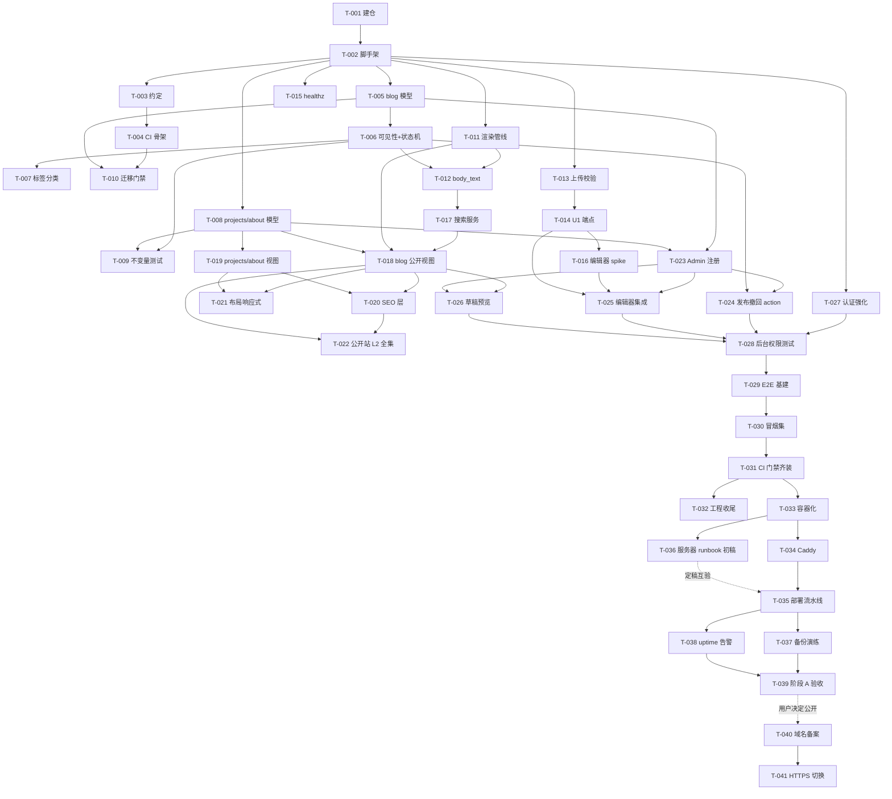

# 开发任务清单与完成定义（第一版实施计划）

> 文档版本：v4.1
> 文档状态：**已批准**（v4.0 基线 2026-10-24 用户确认；v4.1 微调 2026-10-24 用户照准）
> 编写日期：2026-10-23（v4.0 结构整合：2026-10-24）
> v4.0 修订：①通用完成定义迁出为 `definition-of-done.md`（本文 §2 改为指针；"DoD §N"指向该文档）②范围三区/可选增强、风险汇总、用户待办、PLN 决策迁至 `development-plan.md`（§3.4/§12/§14/§15/§16 留指针）③协作细则指向 `development-workflow.md`（原 collaboration-rules.md v1.0 并入，文件已删除）④T-001 白名单按已批准工程初始化方案 v1.0 扩充（+AGENTS.md、.env.example、static/vendor/README.md）⑤41 张任务卡业务内容未改动
> v4.1 修订（2026-10-24 用户照准）：T-002 提交白名单补充 `config/__init__.py`、`config/tests/__init__.py`（v4.0 字面清单遗漏的包标志文件，缺它 Django 包不可导入）；其余 41 张任务卡内容零改动
> **目标**：把已批准的设计文档转化为可执行、可测试、可审查、**可举证**的第一版开发任务序列
> 上游输入（执行者必读，随本计划一起传递）：`requirements-analysis.md` v1.1（已批准）、`technology-decisions.md` v1.0（D-01～D-09 已确认）、`architecture.md`、`database-design.md`、`api-design.md`、`security-design.md`、`deployment-design.md`（五份均 2026-10-23 已批准）
> 文档边界：只定义任务、依赖、验收、完成定义与执行规则；不含业务代码与测试代码，不执行任何任务

## 0. 输入基线确认（2026-10-23）

| 项 | 结论 | 依据 |
|---|---|---|
| 项目范围 | 单作者个人技术博客：访客公开只读 + 单管理员后台 | 需求 v1.1 已批准 |
| 技术栈 | Django 5.2 LTS 模块化单体；模板+HTMX/Alpine；SQLite(WAL)；Django Admin；Caddy+Gunicorn 两容器；GitHub Actions 公开仓库 | D-01～D-09 已确认 |
| V1 必做 | FR-01～23（全 P0）+ CI/CD 全流水线 + 备份脚本 + uptime | 需求 10.1、architecture §8 |
| V1 不做 | 需求 10.2 全部；微服务/Redis/MQ/ES/K8s/Headless CMS/纯 SPA；严格 CSP、2FA、mypy、Sentry 延后 | 需求 10.2、选型 0.3、SEC-3 |
| 未决（不阻塞） | Q-07 正式文案（占位开发，上线前提供）；阶段 B 触发时间 | 需求 §11 |

## 1. 总则

### 1.1 任务卡字段（14 字段）

编号、名称、风险标签、对应章节、目标、前置依赖、修改范围（提交白名单）、实施内容、**验收标准（预期行为+三场景）**、**自动化测试清单**、**DoD 增补（同步四查/禁改/失败恢复/阻塞）**、交付物、工作量（含依据）、Git 约定。**修改范围即提交白名单：PR 中出现白名单之外文件即打回（DoD 第 7 条）。**

### 1.2 全局约束（对一切任务生效）

1. Python 3.14 优先、3.13 兜底（关键依赖轮子不顺即切，不为小版本耗工期）。
2. Django 锁 5.2.x 精确版本；第三方 GitHub Actions 按 commit SHA 固定。
3. SQLite：WAL、busy_timeout≈5000ms、外键开启、synchronous=NORMAL；禁止 NFS。
4. 服务器：阿里云 99 元/年 ECS（2C2G/3M/40G）；镜像在 Actions 构建，服务器只 pull。
5. 公开页首屏 ≤500KB；图片仅 JPG/PNG/WebP/GIF 且 ≤2MB，禁 SVG。
6. 无 REST API、无独立前端工程、无额外常驻服务（R6：未决功能不进 V1）。
7. 数据库唯一读写路径是 Django ORM；迁移只经 makemigrations，禁止手改已应用迁移。
8. 密钥经环境变量 fail-fast 注入；`.env` 不入库，`.env.example` 入库。

### 1.3 工作量与估算依据

S ≈ 0.5 天、M ≈ 1～2 天、L ≈ 2～4 天（单人+Agent 混合节奏的相对估计，PLN-3）。每任务注明类型依据：**配置样板**（框架文档齐全、照抄为主）/ **领域逻辑**（业务规则编码+测试）/ **安全关键**（错错即漏洞，测试面大）/ **前端 JS**（无法单元测试、靠真实浏览器）/ **集成联调**（多环节不确定性）/ **运维文档**。V1 合计约 45 人日（18S+16M+4L），加 20% 缓冲约 54 人日（单人约 10～11 周；数字仅用于排期相对比较）。

### 1.4 Git 与评审约定

- 一任务一分支一 PR：`feat/T-0xx-短名`；PR 内提交序列"测试 → 实现 → 收尾"，**一个提交只做一件事，无关功能必须拆新任务**；合并采用 squash，标题 `T-0xx(模块): 摘要`。
- 代码审查 = PR 评审。无 ⚠ 标签任务走标准评审；⚠ 任务按 DoD §5 对应类别加严（独立评审 + 指定人工复核点）。
- main 恒可部署、恒绿；**打 tag 才部署**（OPS-1）；禁止 force-push 或跳过检查合并。
- 分支命名细则、提交规范全文、PR 检查清单、多 Agent 交接模板、任务状态流转、并行冲突处理与红线操作授权门槛见 **`docs/development-workflow.md`**（协作细则以该文档为准）。

### 1.5 测试总策略

L1（pytest 单元）/ L2（pytest + Django test client 契约）随任务 TDD 先行；L3（Playwright 真实浏览器）旅程在 M5 收口（PLN-4）。**每个任务的验收必须覆盖正常、边界、失败三类场景（DoD 第 2 条）；测试断言必须包含内容断言，仅有状态码断言不足以判定契约正确。**生产环境永不跑写测试，部署后只读冒烟（OPS-5）。

## 2. 完成定义（DoD）——独立成册：`docs/definition-of-done.md`

全部任务通用的完成定义已迁出为独立文档 **`definition-of-done.md`**（已批准），包含：§1 通用 DoD 十条、§2 反模式黑名单、§3 PR 验证记录模板、§4 检查项基线（含类型检查 V1 不适用声明）、§5 高风险五类加严模板（M 迁移/A 认证/I 输入/P 权限/D 部署）、§6 失败处理协议、§7 全局禁改清单。本文档及任务卡中"DoD §N"均指向该文档对应章节。

## 3. 里程碑、依赖与并行分析

### 3.1 里程碑总览

| 里程碑 | 主题 | 任务 | 出口条件 |
|---|---|---|---|
| M0 | 仓库与骨架 | T-001～T-004 | 空项目可跑，CI 骨架绿 |
| M1 | 领域模型 | T-005～T-010 | 模型不变量 L1 全绿，迁移门禁入 CI |
| M2 | core 服务+风险验证 | T-011～T-016 | XSS/上传/healthz 测试全绿，编辑器风险出结论 |
| M3 | 公开站点 | T-017～T-022 | 公开页全部 AC 的 L2 通过 |
| M4 | 后台 Admin | T-023～T-028 | 后台全部 AC 的 L2 通过 |
| M5 | 质量收口 | T-029～T-032 | main 六门禁绿（第六道启用点见 T-033） |
| M6 | 阶段 A 部署 | T-033～T-039 | ECS 上 IP+HTTP 可访问，tag 自动部署演示一次，首轮备份演练完成 |
| M7 | 阶段 B（未来） | T-040～T-041 | 条件触发，不排期 |

### 3.2 依赖图

### 3.3 并行分组与热点文件分析（并行任务不得修改相同核心文件）

**默认串行执行**；下列组可并行（文件集不相交）：

| 并行组 | 任务 | 依据 |
|---|---|---|
| P1 | T-006 ∥ T-008 | blog/ 与 projects/、about/ 分离 |
| P2 | T-011 ∥ M1 各任务 | core/content.py 零项目内依赖；requirements/base.txt 依赖行须串行合并（先 T-011 后 T-013） |
| P3 | T-013 ∥ T-015 | core/uploads.py 与 core/health.py 分离 |
| P4 | T-018 ∥ T-019 | 模板分离；共享 config/urls.py 加行——T-018 先合并，T-019 rebase |
| P5 | T-027 ∥ T-023/T-024 | settings 与各域 admin.py 分离 |
| P6 | T-036 ∥ T-033/T-034 | docs/runbook.md 与 deploy/ 分离 |

**热点文件矩阵**（触及即组内串行合并，后者 rebase）：

| 热点文件 | 触及任务 |
|---|---|
| config/urls.py | T-002、T-014、T-015、T-018、T-019、T-020、T-026 |
| config/settings/*.py | T-002、T-015、T-027、T-033 |
| blog/models.py | T-005、T-006、T-007、T-012 |
| blog/admin.py | T-023、T-024、T-025 |
| templates/base.html | T-018（建）、T-019（用）、T-021（收口） |
| requirements/*.txt、pyproject.toml | T-001、T-003、T-011、T-013、T-027 |
| .github/workflows/ci.yml | T-004、T-010、T-029、T-031、T-033 |

### 3.4 范围三区——见 `development-plan.md` §3

V1 必须（T-001～T-039）／可选增强／未来规划的权威清单与触发条件已迁至总纲 `development-plan.md` §3。

### 3.5 高风险任务与类别标签汇总

| 类别 | 任务 | 共同加严（详见 DoD §5） |
|---|---|---|
| M 迁移 | T-005、T-007、T-008、T-010、T-035 | 迁移正向评审 + 漂移门禁 + 禁改已合并迁移 |
| A 认证 | T-002、T-027、T-041 | 失败场景全覆盖 + 配置逐行人工复核 |
| I 输入 | T-006、T-011、T-013、T-017、T-025 | 攻击语料集 + 拒绝路径断言 |
| P 权限 | T-014、T-018、T-026、T-027、T-028 | 三路径 + 草稿七处可达性复核 |
| D 部署 | T-033～T-037、T-041 | 快照 + 只读冒烟 + 回滚实测 + 中止条件 |

**原则落实**：T-035（首次生产部署）硬前置 = T-031 五道门禁 + T-033 docker build 门禁全绿；生产部署永远排在自动化测试与安全检查之后。

## 4. M0 仓库与项目骨架

#### T-001　建仓与保护
- **对应章节**：ADR-07；deployment §5
- **目标**：公开 GitHub 仓库就绪，密钥入库被结构性阻止
- **前置依赖**：U-3（用户确认账号与仓库名）
- **修改范围（提交白名单）**：README.md、.gitignore、requirements/{base,dev}.txt、LICENSE（如需）、AGENTS.md、.env.example、static/vendor/README.md（后三项依已批准工程初始化方案 v1.0 扩充）
- **实施内容**：①建公开仓库，锁 Django 5.2.x 精确版本 ②README 骨架（定位/文档索引/开发指南占位）③.gitignore（.env、db.sqlite3、media/、__pycache__ 等）④main 保护规则记录在案，T-004 后启用"必过检查"⑤GitHub 远端创建与首次推送在本地初始化后的下一批次完成（本卡收口项，记录在案）
- **验收标准**：预期行为：任何人在新机器克隆仓库后得到与 README 描述一致的目录结构，且 .env 无法被提交。
  - 正常：克隆成功，目录结构与 README 一致
  - 边界：空仓库首次推送全部文件成功
  - 失败：`git add .env` 被 ignore 拦截（`git check-ignore .env` 返回该文件）
- **自动化测试清单**：无自动化测试——理由：纯仓库配置，无代码可测；以人工验证记录替代（克隆操作输出、check-ignore 输出贴 PR）
- **DoD 增补**：同步四查：API 无／迁移 无／配置 无（.env.example 属 T-002）／文档 README 骨架即交付物。禁改：无既有文件。失败恢复：仓库可删除重建，零影响。阻塞：T-002 起全部任务。
- **交付物**：仓库、README 骨架、依赖清单、.gitignore
- **工作量**：S——依据：配置样板
- **Git**：main 初始化；提交 `T-001(repo): 初始化仓库`

#### T-002　Django 脚手架与 settings 拆分 ⚠A
- **对应章节**：architecture §13/M7、AD-9；deployment §7/§8；security §6
- **目标**：五包骨架 + 四套 settings + 环境变量 fail-fast，安全配置从第一天就是生产形态
- **前置依赖**：T-001
- **修改范围（提交白名单）**：manage.py、config/{settings/{__init__,base,dev,test,prod}.py,urls.py,wsgi.py}、{core,blog,projects,about}/{__init__,apps}.py、.env.example、config/tests/test_settings.py、config/__init__.py、config/tests/__init__.py（后两个包标志文件系 v4.1 补入）
- **实施内容**：①startproject/startapp 布局按 architecture §13 ②settings 拆分：base 公共 + dev/test/prod 差异（deployment §7 表逐行对照）③8 个环境变量 fail-fast：SECRET_KEY/DEBUG/SITE_URL/ALLOWED_HOSTS/COOKIE_SECURE/BACKUP_DIR/HEALTHZ_DISK_THRESHOLD/HEALTHZ_BACKUP_MAX_AGE ④USE_TZ=True、TIME_ZONE=Asia/Shanghai ⑤Admin 启用、根 urls 纯 include（仅 admin 占位）⑥dev 本地 .env 示例
- **验收标准**：预期行为：`runserver` 正常起服；缺任一必需环境变量时进程启动即失败并指明缺失变量名；prod settings 永远 DEBUG=False。
  - 正常：`manage.py check` 通过；dev 起服返回欢迎页
  - 边界：8 个环境变量逐个置空/删除（参数化 8 用例）→ 启动失败且报错含变量名
  - 失败场景（防错）：断言 prod settings `DEBUG is False`、`check --deploy` 无致命项——配置错误在 CI 阶段就红
- **自动化测试清单**：`config/tests/test_settings.py`：test_missing_env_fails_with_var_name（参数化×8）、test_prod_debug_false、test_tz_use_tz_true_shanghai、test_check_deploy_no_critical
- **DoD 增补**：同步四查：API 无／迁移 无（Admin 等框架迁移在 T-005 首次 makemigrations 一并产出，白名单含框架迁移）／配置 .env.example 即交付物／文档 README 开发章由 T-003 补。禁改：业务 app 目录内不得写任何业务逻辑（空壳）。失败恢复：分支丢弃重做；阻塞 T-005/T-008/T-011/T-013/T-015/T-027。⚠A 加严：settings 对照 security §6 与 deployment §7/§8 逐行人工复核。
- **交付物**：可运行骨架、.env.example、settings 测试
- **工作量**：M——依据：配置样板但交叉验证面广（四套 settings × 8 变量）
- **Git**：`feat/T-002-scaffold`；提交 test→settings→apps；squash `T-002(config): 脚手架与 settings 拆分`

#### T-003　本地开发约定与工具配置
- **对应章节**：deployment §5/§8；security §6
- **目标**：新环境 30 分钟内可开发，检查命令一键可跑
- **前置依赖**：T-002
- **修改范围（提交白名单）**：pyproject.toml、README.md、.env.example（补注释）、requirements/dev.txt
- **实施内容**：①ruff check+format 规则 ②pytest/pytest-django 配置（test settings）③README 开发/测试/迁移指南 ④.env.example 每变量一行注释
- **验收标准**：预期行为：`ruff check && ruff format --check` 与 `pytest` 在干净检出上一次通过。
  - 正常：三条命令全绿
  - 边界：故意引入一处格式违规 → format --check 必红（验证后还原，证据留 PR）
  - 失败：dev 依赖（pytest 系）不出现在 base.txt（断言式人工核对）
- **自动化测试清单**：无新增测试文件——理由：本任务交付的是检查工具本身；验证=命令输出记录
- **DoD 增补**：同步四查：API 无／迁移 无／配置 pyproject 即交付物／文档 README 即交付物。禁改：config/settings 已合并内容。失败恢复：还原 pyproject 即回退；无阻塞下游（T-004 依赖本任务）。
- **交付物**：pyproject.toml、README 开发章、注释化 .env.example
- **工作量**：S——依据：配置样板
- **Git**：`feat/T-003-dev-conventions`；squash `T-003(tooling): 开发约定与工具配置`

#### T-004　CI 骨架
- **对应章节**：deployment §5；ADR-07
- **目标**：PR 自动跑前两道门禁，分支保护生效
- **前置依赖**：T-003
- **修改范围（提交白名单）**：.github/workflows/ci.yml
- **实施内容**：①workflow：装依赖→ruff check→ruff format --check→pytest ②Actions 按 SHA 固定 ③pip 缓存 ④启用 main 分支保护必过检查（T-001 遗留项收口）
- **验收标准**：预期行为：每个 PR 自动执行四步并给出红绿结论；故意违规必红。
  - 正常：PR CI 绿且连续两次稳定（两次 run 链接留 PR）
  - 边界：空提交重跑结果一致（无 flaky）
  - 失败：故意 lint 错误 → CI 红（验证后还原，证据留 PR）；未过检查的直推 main 被分支保护拒绝
- **自动化测试清单**：无新增测试——理由：CI 是检查机制本身；验证=两次绿 run + 两次人为变红记录
- **DoD 增补**：同步四查：API 无／迁移 无／配置 ci.yml 即交付物／文档 无。禁改：业务代码。失败恢复：还原 workflow 即回退；阻塞 T-010/T-029/T-031。
- **交付物**：ci.yml、分支保护生效记录
- **工作量**：S——依据：配置样板
- **Git**：`feat/T-004-ci-skeleton`；squash `T-004(ci): CI 骨架`

## 5. M1 领域模型与数据层

#### T-005　blog 三模型与初始迁移 ⚠M
- **对应章节**：database §3.1～3.4/§6（DM-1）；需求 §5.1、BR-03
- **目标**：Article/Category/Tag 及 M2M 表按数据字典逐字段落库
- **前置依赖**：T-002
- **修改范围（提交白名单）**：blog/models.py、blog/migrations/0001_initial.py（含框架表）、blog/tests/test_models.py
- **实施内容**：①字段逐项对照 §3.1～3.4：slug CharField(16) 随机 base62-8 冲突重试不可变、summary 200、body_text editable=False、status choices、FK PROTECT/SET_NULL、UNIQUE(slug)、Index(status, first_published_at) ②Category/Tag/中间表 ③迁移 0001（含 auth 等框架表）
- **验收标准**：预期行为：从零建库后，`sqlite3 .schema` 与数据字典 §3.1～3.4 一致；slug 生成器产出 8 位 base62 且库内唯一。
  - 正常：makemigrations/apply 成功；种子字段约束生效（title 必填、summary ≤200、status 默认 draft）
  - 边界：slug 冲突重试成功（模拟碰撞后得到新值）；超长 title 被拒
  - 失败：字段定义与字典漂移 → `makemigrations --check` 红（人为验证一次，证据留 PR）
- **自动化测试清单**：`blog/tests/test_models.py`：test_slug_unique_with_retry、test_slug_charset_length_base62_8、test_title_required、test_summary_max_200、test_status_default_draft、test_category_tag_unique_constraints
- **DoD 增补**：同步四查：API 无／迁移 0001（评审定稿后**禁改**，变更=新迁移）／配置 无／文档 无。禁改：projects/about 目录、config。失败恢复：PR 内迁移可重做；合并后按 DoD §6 迁移级协议；阻塞 T-006/T-007/T-023。⚠M 加严：sqlmigrate 输出贴 PR 供正向评审。
- **交付物**：models.py、迁移 0001、L1 测试
- **工作量**：M——依据：领域逻辑（约束多、无复杂交互）
- **Git**：`feat/T-005-blog-models`；提交 test→models→migration；squash `T-005(blog): 三模型与初始迁移`

#### T-006　可见性边界与状态机 ⚠I
- **对应章节**：architecture AD-6、M1；database §4/§7；BR-04/05/06
- **目标**：`published()` 唯一收口 + publish/withdraw 事务方法
- **前置依赖**：T-005
- **修改范围（提交白名单）**：blog/models.py、blog/tests/test_models.py
- **实施内容**：①published() Manager（七处消费点未来唯一入口）②publish()：守卫四字段，失败抛字段级错误；first_published_at 仅原值为空时写；幂等 ③withdraw()：置 draft 保留首发时间；幂等 ④均 transaction.atomic
- **验收标准**：预期行为：状态机按 database §4 表逐行可复现；守卫失败时不产生任何部分写入。
  - 正常：draft→发布→published 且首发时间写入；撤回→draft 且首发时间保留
  - 边界：撤回后再发布首发时间不变；对已发布重复发布=no-op 成功（幂等）
  - 失败：缺任一守卫字段（标题/摘要/正文/分类，参数化）→ 保持 draft + 字段错误；事务回滚后无半成品（断言无 published 无首发时间的行）
- **自动化测试清单**：`blog/tests/test_models.py`：test_publish_writes_first_published_at_once、test_publish_guard_each_missing_field（参数化×4）、test_publish_atomic_no_partial_write、test_withdraw_keeps_first_published_at、test_publish_withdraw_republish_same_fp_at、test_publish_idempotent、test_withdraw_idempotent
- **DoD 增补**：同步四查：API 无／迁移 无（纯行为）／配置 无／文档 无。禁改：字段结构（属 T-005 白名单）、其他域。失败恢复：分支级；阻塞 T-009/T-012/T-017/T-024。⚠I 加严：守卫属输入校验——失败路径逐项断言（上列参数化组）。
- **交付物**：Manager、状态机、L1 测试
- **工作量**：M——依据：领域逻辑（状态机×事务）
- **Git**：`feat/T-006-visibility-statemachine`；squash `T-006(blog): 可见性边界与状态机`

#### T-007　标签归一化与分类种子 ⚠M
- **对应章节**：database §3.2/3.3、DM-2/DM-7；Q-03、BR-01/02
- **目标**：标签同名不同大小写自动复用；分类三行种子幂等可重放
- **前置依赖**：T-006
- **修改范围（提交白名单）**：blog/models.py、blog/migrations/0002_category_seed.py、blog/tests/test_models.py
- **实施内容**：①Tag.clean：strip+casefold 唯一，命中即复用；中文名 6 位随机 slug、ASCII 名 slugify ②Category 幂等数据迁移（三行种子）③Admin 禁增删挂钩（has_add/delete_permission=False）
- **验收标准**：预期行为："Python"与"python"与"  PYTHON "保存后是同一标签；种子迁移执行任意遍库中恰好 3 行分类。
  - 正常：归一化复用；种子数据正确（tech/practice/notes + sort_order）
  - 边界：种子迁移跑两遍 count==3（幂等）；带首尾空格标签被 strip
  - 失败：非幂等迁移（重复插行）→ 幂等测试红；Admin 试图增删分类被拒
- **自动化测试清单**：`blog/tests/test_models.py`：test_tag_casefold_merge、test_tag_strip_before_match、test_tag_chinese_random_slug、test_tag_ascii_slugify、test_category_seed_idempotent_rerun、test_category_admin_add_delete_forbidden
- **DoD 增补**：同步四查：API 无／迁移 0002（禁改）／配置 无／文档 无。禁改：0001。失败恢复：PR 内重做迁移；阻塞 T-018（分类页）。⚠M 加严。
- **交付物**：clean 逻辑、种子迁移、L1 测试
- **工作量**：S——依据：领域逻辑面窄
- **Git**：`feat/T-007-tags-categories`；squash `T-007(blog): 标签归一化与分类种子`

#### T-008　projects 与 about 模型 ⚠M
- **对应章节**：database §3.5/3.6、DM-3/DM-4；Q-01/02、FR-08～11
- **目标**：Project 全字段 + AboutPage 单例落库
- **前置依赖**：T-002
- **修改范围（提交白名单）**：projects/{models.py,migrations/}、about/{models.py,migrations/}、projects/tests/test_models.py、about/tests/test_models.py
- **实施内容**：①Project：name 80/summary 200/responsibilities 必填、六段 Markdown TextField、tech_stack JSON（≤30 字/项去重）、status 三档、封面 covers/%Y/%m/ 随机名、demo/repo URLField ②AboutPage：get_solo() 单例（get_or_create id=1）、home_summary/bio/direction、三 JSON 字段、clean 至少一项联系方式
- **验收标准**：预期行为：两域模型与 §3.5/3.6 逐字段一致；AboutPage 全库永远只有 id=1 一行。
  - 正常：必填与默认值符合字典；get_solo() 两次返回同一行
  - 边界：tech_stack 重复项与超 30 字项被归一化/拒绝；contacts 与 links 全空 → clean 拒绝
  - 失败：绕过 get_solo 直接创建第二行 about → 单例测试红；URL 非法被 URLField 拒
- **自动化测试清单**：`projects/tests/test_models.py`：test_project_required_fields、test_tech_stack_dedupe_and_limit、test_status_choices_default、test_project_ordering_updated_desc；`about/tests/test_models.py`：test_get_solo_singleton、test_clean_requires_at_least_one_contact、test_about_updated_at_auto
- **DoD 增补**：同步四查：API 无／迁移 两域初始迁移（禁改）／配置 无／文档 无。禁改：blog 目录。失败恢复：PR 内重做；阻塞 T-019/T-023。⚠M 加严。
- **交付物**：两域模型、迁移、L1 测试
- **工作量**：M——依据：领域逻辑（字段多、规则直白）
- **Git**：`feat/T-008-projects-about-models`；squash `T-008(projects,about): 模型与迁移`

#### T-009　模型不变量测试全集
- **对应章节**：database §7 一致性不变量；AC-26
- **目标**：所有"永远为真"的规则锁进测试，成为后续重构安全网
- **前置依赖**：T-006、T-007、T-008
- **修改范围（提交白名单）**：blog/tests/test_invariants.py（新建）、projects/tests/、about/tests/（仅测试文件）
- **实施内容**：published ⇒ 首发时间非空；body_md 变更 ⇒ body_text 同步（**T-012 前以预期失败标记 xfail 占位**）；删除矩阵：删分类 ProtectedError / 删项目文章 project 置空 / 删文章 M2M 级联；M2M 无重复；slug 再保存不变；SQLite PRAGMA（foreign_keys/WAL）断言
- **验收标准**：预期行为：违反不变量的操作全部被数据库或模型层拒绝，且每组拒绝都有断言。
  - 正常：全部不变量在合法操作后保持
  - 边界：恰好处于边界（刚发布/刚撤回）时不变量仍成立
  - 失败：删有文章的分类抛 ProtectedError；断点式检查无 published 且首发时间为空的行
- **自动化测试清单**：`blog/tests/test_invariants.py`：test_published_implies_fp_at、test_delete_category_protected、test_delete_project_nulls_articles、test_delete_article_cascades_m2m、test_m2m_no_duplicate、test_slug_immutable_on_resave、test_sqlite_pragmas_on（body_text 同步两项标 xfail 至 T-012 转正，转正时**删 xfail 标记即断言变更，按 DoD 9 留说明**）
- **DoD 增补**：同步四查：API 无／迁移 无／配置 无／文档 无。禁改：一切模型实现文件（本任务只加测试——发现实现缺陷时**立新缺陷任务**，不得顺手改实现）。失败恢复：无实现风险；阻塞 T-010 前置完备性。
- **交付物**：不变量 L1 测试集
- **工作量**：M——依据：领域逻辑（用例枚举密集）
- **Git**：`feat/T-009-invariants`；squash `T-009(tests): 模型不变量全集`

#### T-010　迁移漂移门禁入 CI ⚠M
- **对应章节**：deployment §5 第 2 道、TST-2
- **目标**：模型与迁移不一致时 CI 直接红
- **前置依赖**：T-004、T-008
- **修改范围（提交白名单）**：.github/workflows/ci.yml
- **实施内容**：门禁序列插入 `makemigrations --check`（ruff 之后、pytest 之前）
- **验收标准**：预期行为：任何未生成迁移的模型改动使 CI 失败；正常 PR 不受影响。
  - 正常：既有代码 CI 绿
  - 边界：与 T-004 空提交重跑一致
  - 失败：故意加字段不生成迁移 → CI 红（证据=run 链接，验证后还原）
- **自动化测试清单**：无新增测试文件——理由：交付物是 CI 门禁；验证=人为变红记录
- **DoD 增补**：同步四查：API 无／迁移 无／配置 ci.yml 即交付物／文档 无。禁改：其他门禁步骤。失败恢复：还原 workflow；无阻塞下游（防护性）。
- **交付物**：ci.yml v2
- **工作量**：S——依据：配置样板
- **Git**：`feat/T-010-migration-gate`；squash `T-010(ci): 迁移漂移门禁`

## 6. M2 core 共享服务与风险验证

#### T-011　Markdown 渲染管线 ⚠I
- **对应章节**：security §4、AD-7、M4 卡片；FR-06、AC-23
- **目标**：`render_markdown(md) -> (html, toc)` 与 `markdown_to_text(md) -> str`，全站唯一安全 HTML 来源
- **前置依赖**：T-002（可与 M1 并行，见 P2）
- **修改范围（提交白名单）**：core/content.py、core/tests/test_content.py、requirements/base.txt（+python-markdown/nh3/pygments）
- **实施内容**：①扩展 fenced_code/tables/toc/codehilite ②nh3 白名单严格按 security §4 表：标签/属性/scheme；img src 仅站内 /media/；link_rel=noopener noreferrer ③净化失败不抛错、输出安全结果 ④markdown_to_text 去标记
- **验收标准**：预期行为：任何含攻击向量的 Markdown 渲染后输出不含可执行内容；合法内容（代码高亮/表格/TOC）完整保留。
  - 正常：标题/列表/表格/代码块渲染正确；TOC 锚点可用；Pygments span 保留
  - 边界：畸形 Markdown 容错渲染不抛错；空串输入输出空；超长输入不崩（耗时接受）
  - 失败（攻击语料，参数化）：`<script>`、`onerror=`、`javascript:`、`data:text/html`、`<iframe>`、`<style>`、外链图床 img src——全部剥离；外链 a 带 noopener
- **自动化测试清单**：`core/tests/test_content.py`：test_render_basic_markdown、test_code_highlight_span_kept、test_toc_anchors、test_xss_script_stripped、test_xss_onerror_stripped、test_xss_javascript_href_stripped、test_xss_data_uri_stripped、test_iframe_style_stripped、test_img_external_src_stripped_only_media、test_link_noopener_injected、test_malformed_md_tolerated、test_to_text_strips_markup、test_empty_input
- **DoD 增补**：同步四查：API 无／迁移 无／配置 requirements +3 依赖（锁定版本）／文档 无。禁改：blog/projects（尚无消费方）。失败恢复：分支级；阻塞 T-012/T-018。⚠I 加严：语料清单与 security §4 验收行逐条对应（人工复核点）；白名单放宽=单独评审。
- **交付物**：content.py、XSS 语料测试、依赖锁定
- **工作量**：M——依据：安全关键（语料覆盖+白名单核对）
- **Git**：`feat/T-011-content-pipeline`；squash `T-011(core): Markdown 渲染管线`

#### T-012　body_text 生成接入 ⚠M
- **对应章节**：DM-6、D-09；database §3.1
- **目标**：Article 保存即重算 body_text
- **前置依赖**：T-006、T-011
- **修改范围（提交白名单）**：blog/models.py（保存路径）、blog/tests/test_invariants.py（xfail 转正）
- **实施内容**：保存钩子调用 markdown_to_text 重算；集中在模型服务层
- **验收标准**：预期行为：任何保存（新建/编辑/草稿/已发布）后 body_text 与 body_md 去标记结果一致。
  - 正常：新建即生成；修改正文后重算
  - 边界：草稿同样生成；正文清空后 body_text 为空串
  - 失败：T-009 两项 xfail 转正失败（同步缺失）→ 测试红
- **自动化测试清单**：`blog/tests/test_invariants.py` 转正：test_body_md_change_regenerates_body_text、test_draft_also_generates_body_text（删 xfail 标记，PR 中按 DoD 9 说明）
- **DoD 增补**：同步四查：API 无／迁移 无（字段已在 0001）／配置 无／文档 无。禁改：core/content.py 接口签名。失败恢复：分支级；阻塞 T-017。⚠M 例外检查：makemigrations --check。
- **交付物**：保存钩子、转正测试
- **工作量**：S——依据：领域逻辑面窄
- **Git**：`feat/T-012-body-text`；squash `T-012(blog): body_text 接入`

#### T-013　图片校验与存储 ⚠I
- **对应章节**：security §5、M5 卡片；Q-05/D-14、AC-24、FR-16
- **目标**：`store_image(file) -> (url, path)`，恶意文件进不来、隐私信息出不去
- **前置依赖**：T-002、T-003
- **修改范围（提交白名单）**：core/uploads.py（校验存储部分）、core/tests/test_uploads.py、requirements/base.txt（+Pillow）
- **实施内容**：①≤2MB ②Pillow 打开+verify ③格式 ∈ JPEG/PNG/WebP/GIF；SVG 与改后缀伪装拒绝 ④JPEG/PNG/WebP 重编码剥 EXIF、GIF 原样 ⑤base62 随机文件名 ⑥uploads/ 与 covers/ 目录
- **验收标准**：预期行为：只有四种真实格式且 ≤2MB 的图片被存储；存储结果无 EXIF、文件名不可预测。
  - 正常：四种格式各一张通过并落盘到正确目录
  - 边界：恰好 2MB 通过、2MB+1 拒绝；同名两次上传文件名不同
  - 失败：SVG 拒绝；文本文件改名 .png 拒绝（魔数不符）；损坏文件（截断）拒绝；含 GPS EXIF 的 JPEG 重编码后 EXIF 消失
- **自动化测试清单**：`core/tests/test_uploads.py`：test_four_formats_accepted、test_svg_rejected、test_fake_extension_rejected、test_truncated_image_rejected、test_exactly_2mb_boundary、test_over_2mb_rejected、test_random_filename_two_uploads_differ、test_exif_gps_stripped、test_gif_kept_as_is
- **DoD 增补**：同步四查：API 无（端点在 T-014）／迁移 无／配置 requirements +Pillow／文档 无。禁改：core/health.py 等无关模块。失败恢复：分支级；阻塞 T-014。⚠I 加严：伪装文件语料（含 `.php` 改名、SVG 内嵌 script）必测。
- **交付物**：uploads.py、L1 测试、依赖锁定
- **工作量**：M——依据：安全关键（格式边界矩阵）
- **Git**：`feat/T-013-uploads`；squash `T-013(core): 图片校验与存储`

#### T-014　U1 图片上传端点 ⚠I⚠P
- **对应章节**：api §4 U1、RV-7；FR-16、AC-17
- **目标**：编辑器可调用的受保护上传接口
- **前置依赖**：T-013
- **修改范围（提交白名单）**：core/uploads.py（端点部分）、core/urls.py（新建）、config/urls.py（加 include 行）、core/tests/test_uploads.py
- **实施内容**：①POST /admin/upload-image/：staff+CSRF；未认证统一 403 JSON（RV-7）②multipart file ③错误码 UNSUPPORTED_TYPE/TOO_LARGE/CORRUPT_FILE + message，真实状态码 ④成功 `{"url": "/media/uploads/..."}`
- **验收标准**：预期行为：仅 staff 持 CSRF 可上传成功；一切拒绝路径返回 4xx + 明确错误码，绝不 200 包错误。
  - 正常：staff 上传 JPEG → 200，响应体含可访问的 /media/ URL（**断言 URL 路径前缀与随机名**，非仅 200）
  - 边界：响应 JSON 键名与 api §4 示例逐字一致
  - 失败（三路径）：未登录 → 403 JSON；登录非 staff → 403；缺 CSRF → 403；错误文件 → 400 + 对应错误码（三种各一例）
- **自动化测试清单**：`core/tests/test_uploads.py`：test_staff_upload_success_url_body、test_anonymous_403_json、test_non_staff_403、test_missing_csrf_403、test_error_unsupported_type_body、test_error_too_large_body、test_error_corrupt_body、test_never_200_with_error
- **DoD 增补**：同步四查：API 实现契约（对照 api §4 U1 行，无需升版）／迁移 无／配置 无／文档 无。禁改：T-013 校验函数签名。失败恢复：分支级；阻塞 T-016/T-025。⚠I+⚠P 加严：三路径+错误体全断言（上列）。
- **交付物**：端点、L2 测试
- **工作量**：S——依据：领域逻辑（核心校验已在 T-013）
- **Git**：`feat/T-014-upload-endpoint`；squash `T-014(core): U1 上传端点`

#### T-015　健康检查
- **对应章节**：architecture M6/AD-10；deployment §11；api §4 H1
- **目标**：/healthz 三项检查覆盖三大静默故障
- **前置依赖**：T-002
- **修改范围（提交白名单）**：core/health.py、core/urls.py、config/urls.py（加行）、config/settings/base.py（阈值读取）、core/tests/test_health.py
- **实施内容**：①DB 可读 ②磁盘余量 ③备份新鲜度 ④200/503 JSON，只报检查项名
- **验收标准**：预期行为：三项任一失败 → 503 且 checks 只含项名与状态；全部正常 → 200。
  - 正常：200 `{"status":"ok"}`
  - 边界：单项失败时其余项仍出现在 checks 中
  - 失败：DB 不可读/磁盘超阈值/备份过期（三项分别注入）各 → 503；响应不含任何文件路径或配置值
- **自动化测试清单**：`core/tests/test_health.py`：test_healthy_200、test_db_failure_503、test_disk_threshold_503、test_stale_backup_503、test_response_has_no_path_leak
- **DoD 增补**：同步四查：API 实现契约（api §4 H1）／迁移 无／配置 settings 读 2 个阈值变量（.env.example 已含）／文档 无。禁改：无关 settings。失败恢复：分支级；阻塞 T-033 healthcheck。
- **交付物**：health.py、测试
- **工作量**：S——依据：领域逻辑面窄
- **Git**：`feat/T-015-healthz`；squash `T-015(core): /healthz 三项检查`

#### T-016　Markdown 编辑器技术验证（spike，一次性）
- **对应章节**：ADR-04"最费劲的一块"；api §5 A4
- **目标**：最早时间回答"EasyMDE/CodeMirror + U1 + 光标插入"能否走通，产出书面结论
- **前置依赖**：T-014
- **修改范围（提交白名单）**：spike/editor/**（独立目录）、docs/spike-editor.md
- **实施内容**：①最小静态页挂 EasyMDE（不顺再试 CodeMirror）②接真实 U1 上传一张图 ③验证 URL 插入光标位置 ④结论写入 docs/spike-editor.md：选型/插回方案/风险/退路判断
- **验收标准**：预期行为：spike 页完成"写两行 Markdown→上传→光标处出现图片语法"闭环；结论文档给出"继续所选方案 / 触发退路"的明确判断。
  - 正常：闭环演示成功（录屏或分步截图留 PR）
  - 边界：上传失败时编辑器内容不丢失
  - 失败：若两家库均不可行 → 明确记录并宣布退路（textarea+手动贴 URL），**这算任务成功**（结论明确即成功）
- **自动化测试清单**：无自动化——理由：一次性技术验证，正式实现的 L3 旅程在 T-030；以人工验证记录（录屏/截图）为证据
- **DoD 增补**：同步四查：API 无／迁移 无／配置 **spike 代码禁止进入 settings/urls/依赖清单**／文档 docs/spike-editor.md 即交付物。禁改：生产代码一切文件。失败恢复：时间盒 0.5 天，超时即触发退路结论；阻塞 T-025。
- **交付物**：spike 页（临时）+ 结论文档（长期）
- **工作量**：S——依据：前端 JS（时间盒限定）
- **Git**：`feat/T-016-editor-spike`；squash `T-016(spike): 编辑器技术验证`

## 7. M3 公开站点

#### T-017　搜索服务 ⚠I
- **对应章节**：D-09/ADR-09；api §3 搜索；FR-03/04、BR-14
- **目标**：`search_articles(q, category, tag)` 组合筛选唯一入口
- **前置依赖**：T-006、T-012
- **修改范围（提交白名单）**：blog/services.py（新建）、blog/tests/test_services.py
- **实施内容**：①q：strip 空→不过滤、截断 100、icontains 三字段 ②tag/category 单选可与 q 组合交集 ③仅 published() ④全 ORM 参数化
- **验收标准**：预期行为：搜索仅命中已发布文章的标题/摘要/正文纯文本；参数注入不产生任何异常或越界结果。
  - 正常：关键词命中三字段各一例；拉丁字母大小写不敏感
  - 边界：q 纯空格=不过滤返回全部已发布；100+ 字符被截断后仍安全执行；组合 q+tag+category 取交集
  - 失败（注入语料，参数化）：`' OR 1=1 --`、`%;DROP TABLE`、`<script>` 作为 q → 不异常、不命中草稿、返回空或正常结果集
- **自动化测试清单**：`blog/tests/test_services.py`：test_search_hits_title_summary_body、test_case_insensitive_latin、test_blank_q_returns_all_published、test_q_truncated_to_100、test_filter_intersection_q_tag_category、test_draft_never_matched、test_injection_payloads_safe（参数化）
- **DoD 增补**：同步四查：API 无（内部服务）／迁移 无／配置 无／文档 无。禁改：models.py。失败恢复：分支级；阻塞 T-018。⚠I 加严：注入语料参数化组。
- **交付物**：services.py、测试
- **工作量**：S——依据：领域逻辑面窄
- **Git**：`feat/T-017-search`；squash `T-017(blog): 搜索服务`

#### T-018　blog 公开视图与模板 ⚠I（草稿泄漏）⚠P
- **对应章节**：api §4 P1～P5；FR-01/02/05/06/07/20、AC-01～07/AC-31、EX-16；AD-6
- **目标**：首页/列表/详情/归档交付，草稿在任何公开路径不可达
- **前置依赖**：T-008、T-011、T-017
- **修改范围（提交白名单）**：blog/public_views.py、blog/urls.py、templates/base.html（首版）、templates/blog/**、core/seo.py（新建 mixin）、config/urls.py（加 include）、blog/tests/test_public_views.py
- **实施内容**：①首页：最新 5 篇 published() 卡片+home_summary（about 域）+三分类入口+空状态 ②列表：10/页、q/tag 经 T-017、带参 noindex、页码非法/越界 404、翻页保留参数、空结果与清除筛选 ③详情：published() 查 slug；草稿/撤回/不存在一律 404；TOC；上下篇相邻 published (first_published_at, id) 边界隐藏；img 带 alt 降级（EX-16）；复制链接反馈+系统分享回退（AC-31）④归档：Asia/Shanghai Python 侧年月分组、不分页、空状态 ⑤canonical/OG 经 core.seo
- **验收标准**：预期行为：四类页面返回正确内容与状态码；**已登录管理员经公开 URL 访问草稿同样 404**。
  - 正常：首页含最新 5 篇标题与摘要、三分类链接（**内容断言**非仅 200）；详情含渲染 HTML 与 TOC 锚点；归档按本地年月分组标题
  - 边界：page=0/-1/abc/超界 → 404（参数化）；恰好 11 篇时第 2 页 1 篇；首页不足 5 篇/全空库各渲染空状态；上下篇在首尾篇隐藏；标签存在但无文章 → 空状态+清除筛选
  - 失败：草稿/撤回/不存在 slug → 404（匿名与 staff 两身份各测）；带 q/tag 响应含 noindex
- **自动化测试清单**：`blog/tests/test_public_views.py`：test_home_latest_five_with_titles、test_home_empty_state、test_list_ten_per_page、test_list_page_invalid_404（参数化）、test_list_eleven_articles_second_page、test_list_pager_keeps_query_params、test_noindex_when_filtered、test_detail_200_with_toc、test_detail_draft_404_anonymous_and_staff、test_detail_withdrawn_404、test_detail_missing_404、test_prev_next_published_only、test_prev_next_hidden_at_boundary、test_archive_local_month_grouping、test_share_button_present
- **DoD 增补**：同步四查：API 实现契约 P1～P5（无需升版）／迁移 无／配置 无／文档 无。禁改：models/services（只读消费）。失败恢复：分支级；阻塞 T-019 合并顺序/T-020/T-021/T-022/T-026。⚠P 加严：七处消费点中本任务覆盖四处，逐一断言（上列）；路由表人工复核。
- **交付物**：四类视图+模板、base.html、seo mixin、L2 测试
- **工作量**：L——依据：领域逻辑+模板量大
- **Git**：`feat/T-018-blog-public`；提交 test→views→templates；squash `T-018(blog): 公开视图与模板`

#### T-019　projects/about 公开视图 ⚠P
- **对应章节**：api §4 P6～P8；FR-08～11、AC-08～10
- **目标**：项目列表/详情、关于页交付，关联文章不泄漏草稿
- **前置依赖**：T-008（与 T-018 并行开发，合并顺序见 P4）
- **修改范围（提交白名单）**：projects/{public_views.py,urls.py}、about/{views.py,urls.py}、templates/projects/**、templates/about/**、config/urls.py（加 include）、{projects,about}/tests/test_public_views.py
- **实施内容**：①项目列表：-updated_at、封面缺失占位、空状态 ②项目详情：空字段区块隐藏；关联文章经 `project.article_set.published()`；id 路由非法 404 ③关于页：全字段、空区块隐藏、外链合法
- **验收标准**：预期行为：项目与关于页内容按 P6～P8 呈现；项目详情的关联文章列表只含已发布。
  - 正常：列表含项目名/状态/封面占位；详情含非空字段区块；关于页含 bio 与至少一联系方式
  - 边界：项目全字段留空（仅必填）→ 空区块隐藏不渲染占位标题；无项目空状态
  - 失败：不存在/非法 id → 404；草稿文章不出现在任何项目关联列表（**关联+草稿混合数据断言**）
- **自动化测试清单**：`projects/tests/test_public_views.py`：test_list_order_updated_desc、test_cover_placeholder_when_missing、test_detail_hides_empty_sections、test_detail_related_published_only_with_mixed_data、test_detail_404；`about/tests/test_public_views.py`：test_about_renders_all_fields、test_about_hides_empty_blocks
- **DoD 增补**：同步四查：API 实现契约 P6～P8／迁移 无／配置 无／文档 无。禁改：blog 域文件（关联查询经反向关系零 import）。失败恢复：分支级；阻塞 T-020/T-021。⚠P：关联路径（七处之五）断言。
- **交付物**：三页面、L2 测试
- **工作量**：M——依据：领域逻辑+模板
- **Git**：`feat/T-019-projects-about-public`；squash `T-019(projects,about): 公开视图`

#### T-020　SEO 层 ⚠P（草稿泄漏）
- **对应章节**：api §4 S1/S2/§3；FR-19、AC-27～30/32、BR-15
- **目标**：sitemap/robots/canonical/OG/404/500 全套
- **前置依赖**：T-018、T-019
- **修改范围（提交白名单）**：config/urls.py（挂载）、{blog,projects,about}/sitemaps.py、config/sitemaps.py（如需聚合）、templates/{404,500}.html、core/seo.py（补全）、各域 tests/test_sitemap.py、config/tests/test_robots_errors.py
- **实施内容**：①sitemap：P1、P2、P3×3、P4×已发布、P5、P6、P7×全部、P8；lastmod=updated_at；排除草稿/搜索/标签页/后台 ②robots：Disallow /admin/、/healthz + Sitemap 行 ③canonical：P2 指无参版其余指自身 ④OG 卡片 ⑤404/500 友好页无堆栈
- **验收标准**：预期行为：sitemap 内容与 api §4 S2 行逐项一致；草稿与撤回内容绝不出现。
  - 正常：sitemap 含全部八类 URL（混合种子数据断言 URL 集合）；robots 三行齐全；canonical/OG 在对应页存在
  - 边界：无文章时 sitemap 仍合法 XML；lastmod=updated_at
  - 失败：草稿/带 q 搜索页/标签页/后台 URL 出现在 sitemap → 测试红；撤回后该文章 URL 从 sitemap 消失；500 页不含堆栈/路径/配置关键词（断言关键词缺失）
- **自动化测试清单**：`blog/tests/test_sitemap.py`：test_sitemap_url_set_matches_spec、test_sitemap_excludes_drafts_and_withdrawn（含撤回后移除）；`config/tests/test_robots_errors.py`：test_robots_disallow_admin_healthz、test_robots_sitemap_line、test_404_uses_friendly_template、test_500_no_stack_leak
- **DoD 增补**：同步四查：API 实现契约 S1/S2／迁移 无／配置 SITE_URL 消费（已有）／文档 无。禁改：视图实现。失败恢复：分支级；阻塞 T-022/T-030。⚠P：七处之六断言。
- **交付物**：SEO 全套、错误页、L2 测试
- **工作量**：M——依据：领域逻辑（规则枚举密集）
- **Git**：`feat/T-020-seo`；squash `T-020(seo): SEO 层与错误页`

#### T-021　布局与响应式
- **对应章节**：FR-21/22、AC-34～36；NFR 性能
- **目标**：统一视觉骨架 + 移动端可用 + 性能预算硬约束
- **前置依赖**：T-018、T-019
- **修改范围（提交白名单）**：templates/base.html、static/css/**、各页面模板（微调）、tests/test_static_budget.py（构建期脚本）
- **实施内容**：①页头/页脚/导航（当前分类高亮）②响应式断点（360px 无横向溢出、代码块横滚）③图片懒加载 ④首屏 ≤500KB 构建期断言 ⑤语义化标题层级/键盘可达/alt 全覆盖
- **验收标准**：预期行为：360px 视口无横向滚动；首屏静态资源总量 ≤500KB 超限即构建失败。
  - 正常：桌面/移动断点渲染正确；导航高亮当前分类
  - 边界：长标题/长代码块不破版（代码块横滚）；键盘 Tab 可达主要操作
  - 失败：资源预算超 500KB → 预算测试红（人为加一张大图验证一次，还原）
- **自动化测试清单**：`tests/test_static_budget.py`：test_home_first_screen_under_500kb；（L3 视口用例 test_viewport_360_no_overflow 在 T-030 执行）
- **DoD 增补**：同步四查：API 无／迁移 无／配置 无／文档 无。禁改：视图逻辑（纯模板/CSS）。失败恢复：还原模板/CSS 即回退；无远端阻塞。视觉验收线=可读/轻量/一致（不做打磨）。
- **交付物**：base.html 终版、全站 CSS、预算脚本
- **工作量**：L——依据：前端模板+CSS 量大
- **Git**：`feat/T-021-layout`；squash `T-021(ui): 布局与响应式`

#### T-022　公开站 L2 契约全集
- **对应章节**：api §2～§4 全表；deployment §4
- **目标**：公开侧全部接口契约一条不缺锁进测试并留映射清单
- **前置依赖**：T-018、T-019、T-020
- **修改范围（提交白名单）**：各域 tests/（仅新增测试文件）
- **实施内容**：P1～P8/S1/S2/H1 逐行断言：方法（他法 405）、trailing slash 缺失 301、状态码、响应体关键内容、noindex 规则、分页边界、RV-5 标签区分、空状态——补齐前序任务未覆盖行
- **验收标准**：预期行为：api §2 接口总表每一行至少一条断言，且 PR 附"接口行 → 测试用例"映射清单。
  - 正常：全表映射无空洞
  - 边界：非 GET 方法访问公开页 → 405（参数化）
  - 失败：缺 trailing slash → 301（目标正确）；映射清单中任何一行指认不到用例 = 任务未完成
- **自动化测试清单**：各域 tests/：按映射清单补齐（清单本身是交付物；预计新增 15～25 条，含 test_method_not_allowed_405、test_missing_trailing_slash_301）
- **DoD 增补**：同步四查：API 本任务即契约验证闭环（发现契约与实现不符→**不改断言迁就实现**，按 DoD 9 上报分歧定夺）／迁移 无／配置 无／文档 无。禁改：实现代码（发现缺陷立新任务）。失败恢复：分支级。
- **交付物**：契约映射清单 + 补齐测试
- **工作量**：M——依据：领域逻辑（枚举密集）
- **Git**：`feat/T-022-public-contracts`；squash `T-022(tests): 公开站契约全集`

## 8. M4 后台 Admin

#### T-023　Admin 注册与定制
- **对应章节**：api §5 A3/A6/A8；FR-14/17/18、AC-13/18/19；ADR-04
- **目标**：三域 Admin 可用：列表、表单校验、删除确认
- **前置依赖**：T-005、T-008
- **修改范围（提交白名单）**：{blog,projects,about}/admin.py（新建）、各域 tests/test_admin.py
- **实施内容**：①列表：状态筛选、-updated_at、关键列 ②文章表单：草稿仅标题必填、slug 创建后只读；项目必填四字段；关于单例禁增删+clean ③删除两步确认（BR-18）；项目删除提示关联文章将解除（EX-12）④Category 禁增删接入
- **验收标准**：预期行为：Admin 表单按 A3/A6/A8 契约工作；非法输入被拦在保存前。
  - 正常：三域列表与表单可用；slug 创建后只读
  - 边界：草稿仅填标题可保存；项目缺任一必填 → 200 重渲染含字段错误（非 500）
  - 失败：关于页尝试新增/删除 → 被拒；删除确认页含二次确认与关联提示文案
- **自动化测试清单**：`blog/tests/test_admin.py`：test_list_status_filter、test_form_draft_title_only、test_slug_readonly_after_create；`projects/tests/test_admin.py`：test_required_four_fields_error_rendered、test_delete_confirmation_mentions_related；`about/tests/test_admin.py`：test_singleton_add_delete_forbidden
- **DoD 增补**：同步四查：API 实现契约 A3/A6/A8／迁移 无／配置 无／文档 无。禁改：模型层。失败恢复：分支级；阻塞 T-024/T-025/T-026。
- **交付物**：三域 Admin、L2 测试
- **工作量**：M——依据：配置样板+领域逻辑
- **Git**：`feat/T-023-admin`；squash `T-023(admin): 三域注册与定制`

#### T-024　发布/撤回 Action ⚠I（状态机守卫）
- **对应章节**：api §5 A5、RV-8；FR-15、AC-14/15
- **目标**：列表页勾选→发布/撤回，事务+幂等
- **前置依赖**：T-023、T-006
- **修改范围（提交白名单）**：blog/admin.py、blog/tests/test_admin.py
- **实施内容**：①发布 action：调 Article.publish()，失败→error message 保持草稿 ②撤回：调 withdraw() ③幂等（RV-8）④不在 action 层直改 status（只调服务方法）
- **验收标准**：预期行为：action 成功 → 302 且状态变更；失败 → 302 带 error message 且状态不变。
  - 正常：发布成功 302，文章进 published；撤回成功保留首发时间
  - 边界：对已发布再执行发布=no-op 成功（幂等）；多选混合（合格+不合格草稿）→ 不合格者保持草稿并有提示
  - 失败：守卫不合格（缺摘要等）→ error message 列明字段；数据库无部分变更（事务）
- **自动化测试清单**：`blog/tests/test_admin.py`：test_action_publish_success_302、test_action_publish_guard_error_message、test_action_publish_mixed_selection_partial、test_action_withdraw_keeps_fp_at、test_action_idempotent_double_run、test_action_no_direct_status_write（评审辅助断言：action 源码只调服务方法）
- **DoD 增补**：同步四查：API 实现契约 A5／迁移 无／配置 无／文档 无。禁改：T-006 服务方法。失败恢复：分支级；阻塞 T-028/T-030。
- **交付物**：两个 action、L2 测试
- **工作量**：S——依据：领域逻辑（核心已在 T-006）
- **Git**：`feat/T-024-publish-actions`；squash `T-024(admin): 发布撤回 action`

#### T-025　Markdown 编辑器集成 ⚠I
- **对应章节**：ADR-04；api §5 A4；FR-14/16、AC-13/17/21
- **目标**：spike 结论落地：三处表单统一编辑体验
- **前置依赖**：T-016（结论）、T-023、T-014
- **修改范围（提交白名单）**：{blog,projects,about}/admin.py、static/js/editor.js、templates/admin/**（widget 模板）、各域 tests/test_admin.py（渲染断言）
- **实施内容**：①按 spike 选型封装可复用 Widget ②上传按钮→U1→URL 插入光标 ③未保存离开确认（AC-21）④退路开关：spike 结论为不可行时切换 textarea+贴 URL 同任务收尾
- **验收标准**：预期行为：三处表单均渲染编辑器；上传后图片语法出现在光标处；有未保存修改时离开弹出确认。
  - 正常：三表单编辑器可用（录屏/分步截图留 PR）
  - 边界：编辑器内已有内容时上传插入位置正确；上传失败编辑器内容不丢失
  - 失败：U1 返回错误码时前端展示失败提示且不插入垃圾文本
- **自动化测试清单**：L2 仅能覆盖渲染与资源：`blog/tests/test_admin.py`：test_editor_widget_rendered、test_editor_assets_loaded；（真实交互= T-030 旅程①，**不在本卡伪造 JS 单测**——依据 TST-1/ADR-02 已声明边界）
- **DoD 增补**：同步四查：API 无（消费 U1）／迁移 无／配置 前端库以锁定版本引入（方式按 spike 结论）／文档 spike-editor.md 补落地记录。禁改：U1 端点。失败恢复：退路方案随时可切（同卡内完成）；阻塞 T-028/T-030。
- **交付物**：编辑器 Widget、editor.js、（如触发）退路记录
- **工作量**：L——依据：前端 JS（spike 已消除不确定性后的工程量）
- **Git**：`feat/T-025-editor-integration`；squash `T-025(admin): 编辑器集成`

#### T-026　草稿预览 ⚠P
- **对应章节**：api §4 V1、RV-3；FR-14
- **目标**：staff 专属预览页，公开路由零草稿可达
- **前置依赖**：T-018（详情模板）、T-023
- **修改范围（提交白名单）**：blog/staff_views.py（新建）、blog/urls.py、config/urls.py（/admin/ 前缀挂载）、templates/blog/preview_banner.html、blog/tests/test_staff_views.py
- **实施内容**：①GET /admin/blog/article/{id}/preview/：staff ②复用公开详情模板+预览横幅 ③noindex ④id 无效 404
- **验收标准**：预期行为：仅 staff 可预览草稿；同一篇文章的公开 slug URL 仍 404。
  - 正常：staff 预览草稿 200 且含横幅与正文
  - 边界：已发布文章也可预览（横幅仍在）；预览页 noindex
  - 失败：匿名 → 302 登录；非法 id → 404；**草稿的公开 slug 同时请求 → 404**（双路由对照断言）
- **自动化测试清单**：`blog/tests/test_staff_views.py`：test_preview_staff_200_with_banner、test_preview_anonymous_302、test_preview_invalid_id_404、test_preview_noindex、test_public_slug_404_while_preview_200
- **DoD 增补**：同步四查：API 实现契约 V1／迁移 无／配置 无／文档 无。禁改：公开视图。失败恢复：分支级；阻塞 T-028。⚠P：挂载位置人工复核（必须在 /admin/ 前缀保护下）。
- **交付物**：预览视图、L2 测试
- **工作量**：S——依据：领域逻辑面窄
- **Git**：`feat/T-026-preview`；squash `T-026(blog): 草稿预览`

#### T-027　认证与会话强化 ⚠A⚠P
- **对应章节**：security §1/§2、SEC-7；api §5 A1/A2/A7；FR-12/13、AC-11/12/20/22、EX-01～04
- **目标**：登录锁定、会话策略、改密闭环全部框架化落地
- **前置依赖**：T-002
- **修改范围（提交白名单）**：config/settings/base.py（axes/会话段）、requirements/base.txt（+django-axes）、config/urls.py（如需）、tests/test_auth.py（新建，置于 config/tests/）
- **实施内容**：①axes：5 次失败锁 15 分钟、锁定期正确密码也拒 ②登录通用错误文案 ③SESSION_COOKIE_AGE=14 天、HttpOnly+SameSite=Lax 复核、COOKIE_SECURE 环境驱动 ④登出 flush ⑤改密启用+四校验器（≥10 位等）⑥PBKDF2 默认哈希
- **验收标准**：预期行为：暴力尝试在 5 次后被锁 15 分钟；改密后旧密码立即失效；会话 cookie 属性与设计一致。
  - 正常：正确凭证进入后台；登出后访问任一 admin URL → 302
  - 边界：第 5 次失败触发锁定；锁定期用**正确**密码仍被拒；冷却期满恢复（测试用短冷却配置）；cookie 含 HttpOnly 与 SameSite=Lax
  - 失败：错误凭证显示通用错误（不区分"账号不存在/密码错"）；弱密码（<10 位/纯数字/常见密码）被校验器拒绝；改密后旧密码登录失败
- **自动化测试清单**：`config/tests/test_auth.py`：test_login_success、test_wrong_password_generic_error、test_lockout_after_5_failures、test_locked_correct_password_rejected、test_lockout_expiry_recovers、test_logout_session_invalid、test_password_change_requires_current、test_old_password_invalid_after_change、test_weak_passwords_rejected（参数化）、test_hash_format_pbkdf2、test_cookie_httponly_samesite
- **DoD 增补**：同步四查：API 实现契约 A1/A2/A7／迁移 axes 表随依赖迁移产出（归本卡白名单）／配置 settings+requirements／文档 无。禁改：业务 app。失败恢复：分支级；阻塞 T-028/T-030。⚠A 加严：settings 认证/会话项对照 security §1 表**逐行人工复核记录留 PR**。
- **交付物**：认证配置、L1/L2 测试、依赖锁定
- **工作量**：S——依据：安全关键但框架内置（测试面大、实现面小）
- **Git**：`feat/T-027-auth-hardening`；squash `T-027(config): 认证与会话强化`

#### T-028　后台权限测试组 ⚠P
- **对应章节**：api §6；deployment §4 权限组；EX-01～04
- **目标**：越权路径全部有断言
- **前置依赖**：T-024、T-025、T-026、T-027
- **修改范围（提交白名单）**：各域 tests/（新增）、config/tests/test_permissions.py
- **实施内容**：未登录遍历全部 admin URL→302；U1/预览拒绝路径复核；CSRF 缺失→403；EX-01～04 映射核对清单
- **验收标准**：预期行为：任何匿名/越权请求得到设计规定的拒绝响应，无一例外。
  - 正常：staff 正常操作不受影响（对照用例）
  - 边界：admin URL 清单**遍历式**参数化（含列表/表单/action/预览/上传）
  - 失败：匿名任一 URL → 302；U1 匿名 → 403 JSON；缺 CSRF POST → 403；EX-01～04 每条有对应用例（映射清单）
- **自动化测试清单**：`config/tests/test_permissions.py`：test_all_admin_urls_redirect_anonymous（参数化遍历）、test_u1_anonymous_403_json_recheck、test_csrf_missing_403、EX 映射清单（交付物）
- **DoD 增补**：同步四查：API 本任务即 §6 结论的测试闭环／迁移 无／配置 无／文档 无。禁改：实现（发现缺陷立新任务）。失败恢复：分支级。
- **交付物**：权限 L2 测试组 + EX 映射清单
- **工作量**：S——依据：领域逻辑（枚举型）
- **Git**：`feat/T-028-admin-permissions`；squash `T-028(tests): 后台权限组`

## 9. M5 E2E 与质量收口

#### T-029　E2E 基建
- **对应章节**：deployment §2/§3、TST-4
- **目标**：CI 内真实服务 + 种子数据，跑完即弃
- **前置依赖**：T-028
- **修改范围（提交白名单）**：e2e/{conftest,seed}.py、.github/workflows/ci.yml（加 job）、requirements/dev.txt（+playwright）
- **实施内容**：①CI 起 test settings 服务（随机端口）②种子：三分类、管理员、已发布/草稿文章、示例项目、关于页 ③Chromium 装帘 ④冒烟：首页 200
- **验收标准**：预期行为：CI 每次自动起真实栈执行浏览器测试，与本地测试物理隔离。
  - 正常：E2E job 绿且连续两次稳定（run 链接留 PR）
  - 边界：随机端口不冲突；测试库用后即弃（无残留）
  - 失败：服务起不来 → job 红（人为制造一次端口占用验证，还原）
- **自动化测试清单**：`e2e/test_smoke.py`：test_home_200（基建验证用例）
- **DoD 增补**：同步四查：API 无／迁移 无／配置 ci.yml+dev 依赖／文档 无。禁改：业务代码。失败恢复：workflow 还原；阻塞 T-030。
- **交付物**：E2E 基建、种子脚本
- **工作量**：M——依据：集成联调（CI 环境不确定）
- **Git**：`feat/T-029-e2e-infra`；squash `T-029(e2e): 基建与种子`

#### T-030　Playwright 冒烟集
- **对应章节**：deployment §1 L3/§4 关键旅程；AC-01/05/11～21/34
- **目标**：四条真实浏览器旅程 + 视口断言全绿且稳定
- **前置依赖**：T-029
- **修改范围（提交白名单）**：e2e/tests/**（新建）
- **实施内容**：①登录→新建→写 Markdown→上传→发布→前台可见 ②撤回→前台 404 ③5 次错误密码→锁定 ④改密→旧会话失效 ⑤360px 无横向溢出
- **验收标准**：预期行为：真实浏览器中核心业务闭环可完成；每个旅程断言**页面内容**（非仅 URL 跳转成功）。
  - 正常：旅程①全步骤通过，前台列表出现新文章标题（内容断言）
  - 边界：旅程②撤回后前台 404 且列表消失；360px 视口断言通过
  - 失败：旅程③锁定后正确密码被拒的 UI 反馈存在；旅程④旧密码再登录失败
- **自动化测试清单**：`e2e/tests/`：test_journey_write_upload_publish_visible、test_journey_withdraw_404_and_delisted、test_journey_lockout、test_journey_password_change_invalidates_old、test_viewport_360_no_overflow
- **DoD 增补**：同步四查：API 无／迁移 无／配置 无／文档 无。禁改：业务代码（发现缺陷立新任务并回补）。失败恢复：flaky 用例修复或剔除并记录（不得静默重跑通过）；阻塞 T-031。
- **交付物**：L3 冒烟集
- **工作量**：L——依据：浏览器联调（等待/选择器/稳定性）
- **Git**：`feat/T-030-e2e-smoke`；squash `T-030(e2e): 冒烟集`

#### T-031　CI 门禁齐装 ⚠D（部署前置）
- **对应章节**：deployment §5 六门禁顺序；ADR-04 决策修正 #3
- **目标**：五道门禁定稿（第六道启用点在 T-033），安全检查全部入链
- **前置依赖**：T-030
- **修改范围（提交白名单）**：.github/workflows/ci.yml、config/settings/prod.py（check --deploy 所需微调）
- **实施内容**：①序列：ruff×2 → makemigrations --check → pytest（含安全组）→ check --deploy → Playwright ②docker build 预留 job 位（T-033 启用）③预算脚本挂载（T-021 产出）④mypy 不入（后置决策，DoD §4 已声明）
- **验收标准**：预期行为：main 全链路绿；任何一道被破坏即整体红。
  - 正常：全链路绿（run 链接留 PR）
  - 边界：门禁顺序与 deployment §5 一致（评审对照）
  - 失败：**每道门禁人为破坏一次各自变红**（五份证据：lint/漂移/测试/check-deploy/E2E，验证后还原）
- **自动化测试清单**：无新增测试文件——理由：交付物是门禁；验证=五次人为变红记录
- **DoD 增补**：同步四查：API 无／迁移 无／配置 ci.yml+prod settings／文档 无。禁改：业务代码。失败恢复：还原 workflow；阻塞 T-033～T-039（**生产部署硬前置**）。
- **交付物**：ci.yml 终版（五道+预留位）
- **工作量**：S——依据：配置样板
- **Git**：`feat/T-031-ci-gates`；squash `T-031(ci): 门禁齐装`

#### T-032　覆盖率与工程收尾
- **对应章节**：TST-3；AC-38
- **目标**：覆盖率报告（不设门槛）+ 工程文档收口
- **前置依赖**：T-031
- **修改范围（提交白名单）**：ci.yml（报告步）、README.md、docs/（指南补全）
- **实施内容**：①pytest-cov 报告仅展示（TST-3 防指标博弈）②README：徽章/本地复跑/目录结构 ③文档索引核对
- **验收标准**：预期行为：报告在 CI 产出；新人按 README 从零复现全部检查。
  - 正常：报告链接可访问；README 步骤可照抄执行
  - 边界：报告不阻塞合并（不设门槛验证）
  - 失败：README 步骤执行不通 → 修正后复跑（执行记录留 PR）
- **自动化测试清单**：无新增——理由：文档与报告配置；验证=按 README 实操一遍记录
- **DoD 增补**：同步四查：API 无／迁移 无／配置 ci.yml 报告步／文档 README 即交付物。禁改：测试文件（不得为覆盖率写废测试，TST-3）。失败恢复：文档可随时修订。
- **交付物**：报告配置、README 终版
- **工作量**：S——依据：文档收尾
- **Git**：`feat/T-032-coverage-docs`；squash `T-032(ci,docs): 覆盖率与收尾`

## 10. M6 阶段 A 部署上线

> **进入 M6 的硬前置（原则：生产部署排在自动化测试与安全检查之后）**：T-031 五道门禁 + T-033 docker build 门禁全绿。

#### T-033　容器化 ⚠D
- **对应章节**：architecture §3、AD-1；deployment §9；ADR-03
- **目标**：web+caddy 两容器本地可起，第六道门禁启用
- **前置依赖**：T-031
- **修改范围（提交白名单）**：deploy/{Dockerfile,docker-compose.yml,.dockerignore}、ci.yml（启用第六道）、docs/deploy-local.md（本地起服说明）
- **实施内容**：①Dockerfile：Python 3.14（兜底 3.13）、非 root、Gunicorn 2w×2t timeout 30s ②compose：两容器、bind mount /srv/blog/{data,media,static}、healthcheck /healthz、restart: unless-stopped ③镜像零密钥 ④CI docker build 门禁启用
- **验收标准**：预期行为：本地 compose 起服后站点可用；容器以非 root 运行且不含 .env。
  - 正常：`docker compose up` 后首页与 /healthz 200（输出留 PR）
  - 边界：media 上传可写（bind mount 权限）；容器重启后数据仍在（data 卷）
  - 失败：镜像内发现 .env 或密钥文件 → 验证用例红；容器以 root 运行 → 拒绝合并；CI docker build 失败=门禁红（证据留 PR）
- **自动化测试清单**：无独立 pytest——验证=CI docker build 门禁 + 本地 compose 冒烟记录（`docker exec whoami` 非 root、`docker exec ls` 无 .env——输出留 PR）
- **DoD 增补**：同步四查：API 无／迁移 无／配置 compose 环境变量经 .env（模板入 deploy/.env.example）／文档 deploy-local.md。禁改：业务代码。失败恢复：镜像可重建，本地失败无生产影响；阻塞 T-034/T-035。⚠D 加严：人工复核清单（非 root/零密钥/挂载路径）。例外检查：check --deploy。
- **交付物**：Dockerfile、compose、第六道门禁
- **工作量**：M——依据：集成联调
- **Git**：`feat/T-033-containers`；squash `T-033(deploy): 容器化`

#### T-034　Caddy 配置 ⚠D
- **对应章节**：deployment §9；RV-6；security §3 基础头
- **目标**：反向代理与静态直读终版
- **前置依赖**：T-033
- **修改范围（提交白名单）**：deploy/Caddyfile、deploy/scripts/header_check.sh（验证脚本）
- **实施内容**：①反代 127.0.0.1:8000 ②/static/ /media/ 直读+长缓存 ③gzip/zstd ④安全头三件套 ⑤/admin/* 注入 noindex（RV-6）⑥阶段 A HTTP（域名配置留注释模板给 T-041）
- **验收标准**：预期行为：动态请求经 Python、静态由 Caddy 直读；全部安全头到位。
  - 正常：页面 200 且响应含 nosniff/Referrer-Policy/X-Frame-Options（脚本断言）
  - 边界：/admin/ 响应含 X-Robots-Tag: noindex；静态文件命中长缓存头
  - 失败：安全头任一缺失 → 脚本非零退出；媒体目录列目录被拒；静态请求不出现在 Gunicorn 日志（直读验证）
- **自动化测试清单**：`deploy/scripts/header_check.sh`（本地集成断言脚本，输出留 PR；CI 无法起真实 Caddy 的部分在 T-035 后实机复验）
- **DoD 增补**：同步四查：API 无／迁移 无／配置 Caddyfile 即交付物／文档 无。禁改：Django 侧安全头（避免重复注入）。失败恢复：Caddyfile 可回退；阻塞 T-035。
- **交付物**：Caddyfile、头验证脚本
- **工作量**：S——依据：配置样板
- **Git**：`feat/T-034-caddy`；squash `T-034(deploy): Caddy 配置`

#### T-035　部署流水线（首次上线）⚠D
- **对应章节**：deployment §12、OPS-1/2/3/7；ADR-07
- **目标**：打 tag → 全自动上线，快照先行、只读冒烟、可回滚
- **前置依赖**：T-033、T-034、T-036 初稿、六道门禁全绿、U-4（ECS 就绪）
- **修改范围（提交白名单）**：.github/workflows/deploy.yml（新建）、deploy/scripts/{deploy,rollback}.sh（新建）
- **实施内容**：①tag 触发 ②构建推 GHCR ③SSH 序列：**快照→pull→migrate→collectstatic→up -d** ④只读冒烟四 URL（/healthz、/、/articles/、/sitemap.xml）⑤非 root 部署用户、Secrets 托管、主机指纹固定 ⑥回滚脚本=重部署上一 tag
- **验收标准**：预期行为：一次 tag 推送完成全自动上线，四 URL 冒烟 200；回滚脚本实测可用。
  - 正常：全链路成功（每步日志摘要留 PR）；冒烟四 URL 200（输出留 PR）
  - 边界：部署前快照存在且时间戳正确（OPS-3 证据）；迁移步骤在服务更新前完成（顺序断言=日志顺序）
  - 失败（中止条件演练）：人为使冒烟失败一次 → 流水线自动中止/标记失败 → **执行回滚脚本回到上一 tag 成功**（演练记录留 PR）；迁移失败=整体失败不半部署（事务性 DDL）
- **自动化测试清单**：无独立 pytest——验证=首次部署全链路记录 + 回滚实测记录（⚠D 证据要求）
- **DoD 增补**：同步四查：API 无／迁移 生产首次 migrate（向后兼容声明 OPS-2）／配置 Secrets 清单（名称留档，值不入库）／文档 runbook 定稿互验。禁改：业务代码。失败恢复：DoD §6 部署级——冒烟不过立即回滚；阻塞 T-036 定稿/T-037/T-038/T-039。⚠D 全项加严。
- **交付物**：deploy.yml、部署/回滚脚本、首次部署+回滚演练记录
- **工作量**：M——依据：运维集成（多环节+大陆网络镜像加速）
- **Git**：`feat/T-035-deploy-pipeline`；squash `T-035(ci): 部署流水线`

#### T-036　服务器初始化 Runbook ⚠D
- **对应章节**：deployment §12 runbook 表、OPS-6；AD-8；ADR-06 阶段 A
- **目标**：从零重建服务器的可照抄手册
- **前置依赖**：U-4；初稿可与 T-033/034 并行（P6），T-035 前定稿
- **修改范围（提交白名单）**：docs/runbook.md（新建）
- **实施内容**：①ECS 初始化与安全组（80 公开；后台仅 SSH 隧道/本人 IP）②/srv/blog 目录与属主 ③非 root 部署用户 ④cron 每日 02:00 sqlite3 .backup + media tar 保留 14 天 ⑤日志轮转 ⑥镜像加速 ⑦故障排查表全量落位 ⑧阶段 B 切换清单
- **验收标准**：预期行为：照手册可从裸机到服务可用；公网无法直访后台。
  - 正常：按书执行全流程成功（与 T-035 互验记录）
  - 边界：cron 与应用时区一致（02:00 语义明确）；磁盘余量满足 14 天备份空间估算
  - 失败：公网直访 http://IP/admin/ 不可达复测（证据留 PR）；某步骤执行不通 → 手册修订后重走该段
- **自动化测试清单**：无自动化——理由：运维手册；验证=实操记录+后台不可达复测证据
- **DoD 增补**：同步四查：API 无／迁移 无／配置 服务器侧（手册内容即配置）／文档 本卡即文档。禁改：deploy/ 代码（步骤不通用时与 T-033/034 联动修订）。失败恢复：服务器可重置重走；阻塞 T-035 定稿/T-037。
- **交付物**：docs/runbook.md
- **工作量**：M——依据：运维文档（步骤多须实测）
- **Git**：`feat/T-036-runbook`；squash `T-036(docs): 服务器 runbook`

#### T-037　首轮备份恢复演练 ⚠D
- **对应章节**：ADR-08、database §8；OPS 恢复流程
- **目标**：证明备份真的能恢复，形成月度清单
- **前置依赖**：T-035
- **修改范围（提交白名单）**：docs/runbook.md（演练章）、deploy/scripts/backup-verify.sh（如需）
- **实施内容**：①停写入窗口 ②快照恢复到临时目录 ③起应用验证文章/图片/关于页 ④记录耗时与问题 ⑤月度清单文档化 ⑥备份目录权限 600 复核
- **验收标准**：预期行为：恢复实例数据完整可读；演练后 /healthz 备份新鲜度检查转绿。
  - 正常：文章数/图片数/关于页字段与线上一致（核对清单）
  - 边界：演练耗时记录在案（月度例行成本基线）
  - 失败：恢复数据缺任一实体 → 演练失败，**T-039 不得开始**，问题立新任务
- **自动化测试清单**：无独立 pytest——验证=数据核对清单+healthz 转绿证据（T-015 用例在线上复验）
- **DoD 增补**：同步四查：API 无／迁移 无／配置 无／文档 演练章即交付物。禁改：生产数据（只读恢复到临时目录）。失败恢复：演练本身即恢复能力验证；失败不影响线上（只读操作）。阻塞 T-039。
- **交付物**：演练记录、月度清单
- **工作量**：S——依据：运维操作（已文档化）
- **Git**：`feat/T-037-backup-drill`；squash `T-037(docs): 首轮备份演练`

#### T-038　Uptime 与告警
- **对应章节**：deployment §11；ADR-08
- **目标**：外部探测 + 邮件告警通道打通
- **前置依赖**：T-035、U-2（邮箱）
- **修改范围（提交白名单）**：docs/runbook.md（监控章）
- **实施内容**：①外部 uptime 探测 /healthz ②告警到 U-2 邮箱 ③磁盘/备份过期经 503 同通道 ④验证告警触发与恢复
- **验收标准**：预期行为：服务不可用→邮箱收到告警；恢复→收到恢复通知。
  - 正常：探测绿
  - 边界：告警延迟在可接受范围记录在案
  - 失败（演练）：人为停服一次 → 告警邮件到达（截图留 PR）；恢复 → 恢复通知到达
- **自动化测试清单**：无自动化（外部服务）；503 路径已有 T-015 测试背书（引用）
- **DoD 增补**：同步四查：API 无／迁移 无／配置 外部平台配置（步骤记录入 runbook，凭证不入库）／文档 runbook 监控章。禁改：应用代码。失败恢复：平台配置可重做。阻塞 T-039（软性）。
- **交付物**：监控配置记录、演练证据
- **工作量**：S——依据：外部服务配置
- **Git**：`feat/T-038-uptime`；squash `T-038(ops): uptime 与告警`

#### T-039　阶段 A 验收 ⚠D（汇总）
- **对应章节**：需求 §8 全部 AC；ADR-06 阶段 A
- **目标**：V1 对照验收标准逐条核对并获用户确认
- **前置依赖**：T-035～T-038、U-1（文案若已提供则替换占位）
- **修改范围（提交白名单）**：docs/acceptance-stage-a.md（新建）；缺口修复走新任务
- **实施内容**：①AC-01～38 分层核对（已覆盖项引用测试/CI 证据链接，不重复执行）②AC-27～29 结构性验证（不做收录验证，ADR-06）③公网直访 /admin/ 不可达复测 ④SITE_URL=IP 下 canonical/sitemap 抽查 ⑤全站人工浏览（含移动端）⑥遗留问题清单
- **验收标准**：预期行为：38 组 AC 每条有"通过（证据链接）/有据可延后（理由）"结论；用户确认。
  - 正常：核对清单完整填写
  - 边界：延后项均有批准依据（如收录验证属阶段 B）
  - 失败：发现缺口 → 入遗留清单排期，**不得标通过**；缺口涉及安全 → 立即修复优先
- **自动化测试清单**：无新增——本任务汇总引用既有证据（证据链完整性本身是验收内容）
- **DoD 增补**：同步四查：API 无／迁移 无／配置 无／文档 验收记录即交付物。禁改：一切代码（验收任务）。失败恢复：N/A（记录性任务）；产出驱动后续排期。
- **交付物**：验收记录（含用户确认日期）
- **工作量**：M——依据：验收枚举+人工浏览
- **Git**：`feat/T-039-acceptance`；squash `T-039(docs): 阶段 A 验收记录`

## 11. M7 阶段 B（未来规划，条件触发，不排期）

#### T-040　域名与备案（简卡）
- **对应章节**：ADR-06 阶段 B。**前置**：U-5。**内容**：购域名→ICP 备案（1～3 周）→解析。**验收**：备案号下发、解析生效（dig 记录）。**工作量**：外部流程为主。**Git**：无代码。
#### T-041　切 HTTPS 与复核（简卡）⚠A⚠D
- **对应章节**：ADR-06、SEC-1/SEC-8。**前置**：T-040。**内容**：SITE_URL 切域名；Caddy 自动证书；COOKIE_SECURE=true、SECURE_PROXY_SSL_HEADER、SECURE_SSL_REDIRECT（HSTS 稳定后）；E2E 断言 canonical/sitemap 域名；提交搜索引擎；OWASP ZAP baseline 人工评估（一次性）。**验收（加严）**：HTTPS 全绿、AC-27～29 复核、ZAP 报告归档、切换清单逐项勾选（runbook §阶段 B）。**工作量**：M。**Git**：`feat/T-041-https-cutover`。

## 12. 可选增强清单——见 `development-plan.md` §3

详细触发条件与留缝位置表已迁至总纲 `development-plan.md` §3（可选增强区）。

## 13. 验收映射

### 13.1 FR → 任务

| 需求 | 任务 | 需求 | 任务 |
|---|---|---|---|
| FR-01～03 | T-017、T-018 | FR-13 | T-027 |
| FR-04 | T-017 | FR-14 | T-023、T-025、T-026 |
| FR-05～07 | T-011、T-018 | FR-15 | T-023、T-024 |
| FR-08～10 | T-008、T-019 | FR-16 | T-013、T-014、T-025 |
| FR-11 | T-008、T-019 | FR-17/18 | T-008、T-023 |
| FR-12 | T-027 | FR-19 | T-020 |
| FR-20 | T-018 | FR-21 | T-018/019/020 |
| FR-22 | T-021 | FR-23 | T-011、T-013、T-027 |

### 13.2 里程碑 → AC 组 → 测试层

| 里程碑 | AC 组 | 层 |
|---|---|---|
| M1 | AC-26（数据一致性） | L1 |
| M2 | AC-23（净化/CSRF）、AC-24（上传安全） | L1+L2 |
| M3 | AC-01～10、AC-27～33 | L2 为主，AC-01/05 加 L3 |
| M4 | AC-11～22、AC-25（robots 应用侧） | L2+L3 |
| M5 | AC-34～38 | L3+构建期断言+CI 本身 |
| M6 | AC-25 实机复核（Caddy 头）、备份恢复演练（ADR-08） | 运维验证 |
| M7 | AC-27～29 收录复核、ZAP 基线 | 人工+外部 |

## 14. 风险任务与应对——见 `development-plan.md` §5

风险登记册（含未决问题与应对）已迁至总纲 `development-plan.md` §5。

## 15. 用户侧待办——见 `development-plan.md` §6

U-1～U-5 清单已迁至总纲 `development-plan.md` §6。

## 16. 计划决策 PLN-1～PLN-10——见 `development-plan.md` §7

计划级决策记录（PLN-1～PLN-10）已迁至总纲 `development-plan.md` §7；本文 §1.3/§1.5 中的"PLN-N"指涉不变。

## 17. 执行工作流与下一步

1. **本计划已批准（2026-10-24 生效）；执行从 T-001 开始，按批次推进。**
2. 批准后从 T-001 串行起步；§3.3 并行组须遵守热点文件规则。
3. 一任务一分支一 PR；**PR 描述必须包含 DoD §3 验证记录**（缺验证记录的 PR 不得评审）；门禁随里程碑渐进（M0 两道 → M1 三道 → M5 五道 → T-033 起六道）。
4. 执行者（Agent 或人）必须同读任务卡与"对应章节"指向的设计条目；设计与现实冲突时停下修订文档并升版，不得绕过，**不得修改断言迁就实现**（DoD 9）。
5. 每完成一个里程碑向用户汇报出口条件达成情况（附各任务 PR 证据链接），确认后进入下一里程碑。
6. 执行期协作（角色分工、交接、状态流转、红线授权）遵循 `docs/development-workflow.md`。
